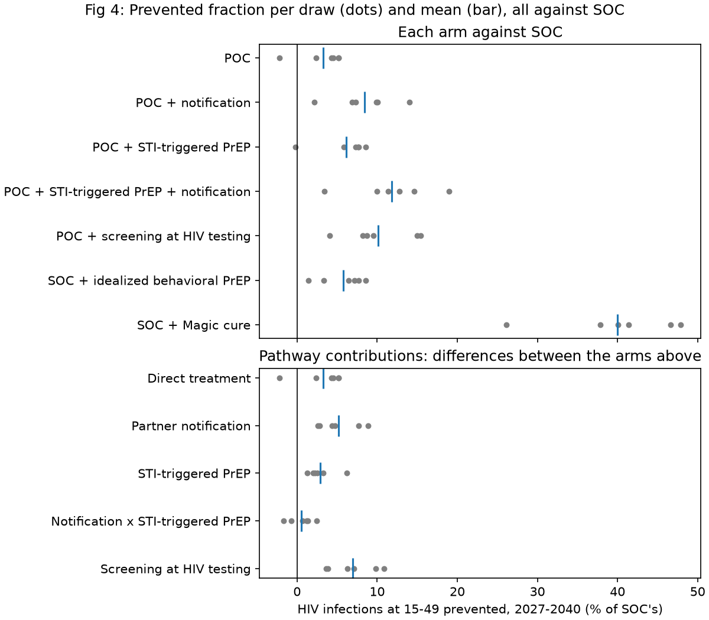
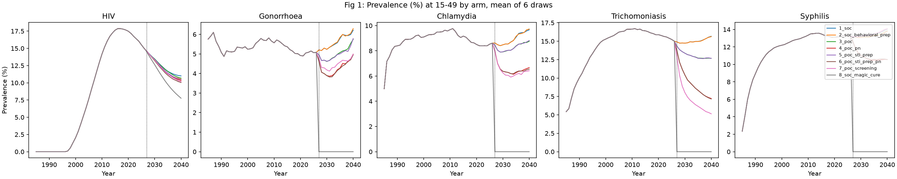
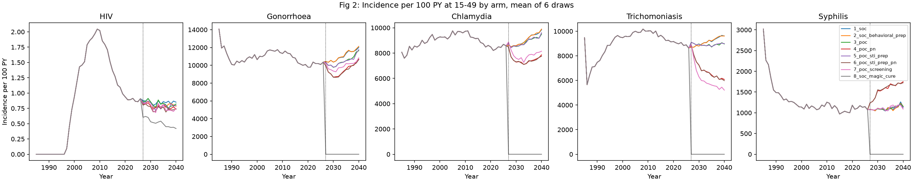
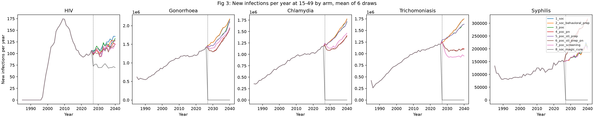

# Exp 001: All eight arms on six Zimbabwe draws

**Date:** 2026-11-18.

**Question.** What do the eight arms of the
[pathway decomposition](../../../docs/pages/pathway-decomposition-arm-design.md) look like
side by side in one setting? This was a quick look with no experiment issue, using the six
Zimbabwe draws from [38.3](../../settings/38.3_seed_year_lower_sti_beta/SUMMARY.md) closest
to 15% HIV prevalence at 15-49 in 2026 (their 2026 prevalence is 14.9-15.1%). Each draw ran all eight arms on its
38.3 seed: 10,000 agents, 1985 to the end of 2040, interventions from 2027.

**Result.** All eight arms ran as designed, the Magic cure and idealized behavioral PrEP after fixes
and reruns. Every arm is measured against SOC's HIV infections at 15-49 over 2027-2040, so pathway contributions add. POC prevented 3.2% of
SOC's infections (-2.2 to 5.2% across draws), and POC with STI-triggered PrEP and
notification prevented 11.8% (3.4 to 19.0%). That 11.8% splits into pathway
contributions, each a percentage of SOC's infections with its range across draws:

| Pathway | Mean | Range |
|---|---|---|
| Direct treatment | 3.2% | -2.2 to 5.2% |
| Partner notification | 5.2% | 2.6 to 8.8% |
| STI-triggered PrEP | 2.9% | 1.3 to 6.2% |
| Notification x STI-triggered PrEP interaction | 0.5% | -1.7 to 2.4% |

The interaction is indistinguishable from zero. Screening at HIV testing prevents a further
6.9% of SOC's infections on top of POC (3.6 to 10.9%). The Magic cure, which removes the
four STIs for good in 2027, prevents 40.0% of SOC's infections (26.2 to 47.9%), so direct
treatment and notification together reach about a fifth of the most that clearing the
STIs could prevent. Idealized behavioral PrEP on SOC prevents 5.8% of SOC's infections (1.4 to
8.6% across draws), close to the 6.1% over 2027-2040 (-0.2 to 8.6% across
draws) of POC with STI-triggered PrEP. Idealized behavioral PrEP starts 13,307 PrEP courses
per draw over 2027-2040, and STI-triggered PrEP 4,700 (observation 9). Its screen is
answered truthfully by everyone at a visit, so its effect is unrealistically high, and the
arm tests behavioral targeting under ideal conditions.

## Observations

1. All 48 simulations finished on 48 workers on zebra, with a run time of 284 s per
   simulation and 285 s for the whole batch. The
   per-draw prevented fractions against SOC are in `outputs/prevented_fractions.csv`, and
   the pathway contributions in `outputs/pathway_components.csv`.

2. In the first run the Magic cure arm matched SOC exactly in every year of every draw,
   because `MagicCure` cleared infections in copies of the diseases that the sim never
   stepped. After the fix (commit `beaca4b`) its six simulations were rerun on the same
   draws and seeds, at 214-219 s each. The first run's rows are kept in
   `outputs/results_magic_cure_unfixed.jsonl`. The other seven arms do not contain
   `MagicCure`, so their results stand.

3. With the fix, mean prevalence at 15-49 of all four STIs is 0.0% in every year from 2027
   to 2040, so nothing reintroduces them. SOC HIV incidence at 15-49 is 0.88 per 100
   person-years in 2027 and 0.85 in 2040. Under the Magic cure it is 0.60 per 100
   person-years in 2027, the first year, and 0.42 in 2040. Its 40.0% prevented fraction is
   above the 3-17% attributable ceiling for a mature epidemic in the
   [STI-HIV cofactor synthesis](../../../docs/pages/sti-hiv-cofactor.md). Bacterial vaginosis
   stays in place, so the cure leaves its cofactor running.

4. In the first run the behavioral PrEP arm separated from the other seven long before PrEP
   started. In 2026 its HIV prevalence at 15-49 was above SOC's in all six draws, by 0.7
   to 1.9 percentage points depending on the draw, and its 2027-2040 prevented fraction against SOC was -7.9% (-15.0 to -0.2%). The
   behavioral screen switched on the sexual network's `record_expired` flag to learn of
   ended partnerships, and the flag changes the network's dynamics. After the fix (commit
   `2bd1ec4`) the screen finds ended partnerships itself, and the arm's six simulations
   were rerun on the same draws and seeds, at 249-255 s each. Its HIV and STI prevalence
   now match SOC exactly in every year before 2027 in every draw. The first run's rows are
   kept in `outputs/results_behavioral_prep_unfixed.jsonl`. No other arm runs the screen.

5. One seed per draw is too few for contrasts of about 3%. Under SOC the agents have 1,432
   to 1,864 HIV infections at 15-49 over 2027-2040 per draw, so a 3% effect is about 50
   infections. Draw 0369 gives -2.2% for direct treatment and -0.2% for POC with
   STI-triggered PrEP. Direct treatment and STI-triggered PrEP are the two contrasts with a
   draw at or near zero.

6. Most of the extra treatment POC delivers is for trichomoniasis. Over 2027-2040, the mean
   per draw in agents:

   | Infection | SOC symptomatic | SOC asymptomatic | POC symptomatic | POC asymptomatic |
   |---|---|---|---|---|
   | Trichomoniasis | 1,211 | 1,530 | 6,803 | 3,333 |
   | Gonorrhoea | 11,912 | 1,425 | 12,572 | 1,948 |
   | Chlamydia | 7,811 | 3,161 | 8,145 | 3,674 |

   Even so, POC lowers trichomoniasis prevalence at 15-49 in 2040 only from 15.7% to
   12.7%. It leaves gonorrhoea and chlamydia within 1 percentage point of SOC: both drop
   in 2027 and climb back by about 2035 (Fig 1).

7. Screening at HIV testing and partner notification lower STI prevalence far more than
   POC alone. Trichomoniasis prevalence in 2040 is 5.1% with screening and 7.2% with
   notification, against 12.7% under POC. Chlamydia prevalence at 15-49 in 2040 is 6.4% with
   screening and 6.7% with notification, against 8.8% under POC.

8. Partner notification raises syphilis incidence while lowering its prevalence. Incidence
   at 15-49 in 2040 is 2.0 per 100 person-years with notification against 1.3 under POC,
   while prevalence (any stage) falls from 14.0% to 10.6%. Over 2027-2040, notification
   treats 2,433 asymptomatic syphilis infections per draw against 626 under POC. One
   possible explanation, not checked: people treated for latent syphilis become
   susceptible again and are reinfected.

9. Idealized behavioral PrEP enrolls nearly three times as many people as STI-triggered
   PrEP, and averts fewer infections per start. Over 2027-2040, mean per draw in agents:

   | PrEP arm, against its own baseline | PrEP starts | On PrEP in 2035 | HIV infections at 15-49 averted per 1,000 starts |
   |---|---|---|---|
   | Idealized behavioral PrEP, against SOC | 13,307 | 250 | 7.1 (2.4 to 10.7) |
   | STI-triggered PrEP, against POC | 4,700 | 87 | 10.2 (7.3 to 13.4) |

   With notification, STI-triggered PrEP starts 5,415 courses, with 98 people on PrEP in
   2035. Both arms run the same cascade at 30% uptake of offers, so the difference in
   volume comes from how many people each rule offers PrEP to.

   The behavioral screen is idealized. Every HIV-negative person aged 15 and over at an
   HIV testing or STI clinic visit is screened, and every item reads the model's true
   state, so nobody underreports partners or sex work. Any non-stable partnership with
   condom use below 100% counts as condomless, and every genital ulcer is a syphilis
   chancre. Its prevented fraction and its infections averted per start are therefore
   unrealistically high: they show how well behavioral targeting does under ideal
   conditions.

10. The STI incidence in Fig 2 and the STI counts in Fig 3 are on the wrong scale. stisim's
   STI new infections are scaled to the Zimbabwe population (`pop_scale` 868.7), but the
   person-years and the HIV counts are agent counts. Fig 2's STI incidence is therefore
   869 times too high. Fig 3 plots population-scaled STI counts next to agent-count HIV
   infections, so most of the STI growth it shows is population growth. Rescaled, SOC
   incidence at 15-49 in 2026 is 11.9 per 100 person-years for gonorrhoea, 9.9 per 100
   person-years for chlamydia, 9.9 per 100 person-years for trichomoniasis and 1.2 per 100
   person-years for syphilis. HIV trajectories, STI
   prevalence and the prevented fractions are unaffected. Under SOC, HIV prevalence at
   15-49 falls from 15.0% in 2026 to 11.0% in 2040, and incidence from 0.91 to 0.85 per
   100 person-years.

## Next

- Check, in the model's cofactor values, why the Magic cure's 2027-2040 prevented fraction
  of 40.0% sits above the STI-HIV cofactor synthesis's 3-17% attributable ceiling for a
  mature epidemic.
- Divide the STI new infections by `pop_scale` in `run.py` and regenerate the figures with
  `--plot-only`.
- Run several seeds per draw to resolve the contrasts of about 3%: direct treatment and
  STI-triggered PrEP.
