# Exp 44: Prevented fractions of HIV infections on the four settings' ensembles

**Date:** 2026-11-18 (stages 1 and 2).

**Question.** How much of SOC's HIV infections at 15-49 over 2027-2040 does each arm
prevent in each of the four settings, and how wide is the spread across each setting's 30
ensemble members? [001-quick](../001-quick/SUMMARY.md) ran the arms on six Zimbabwe draws,
too few to separate contrasts of about 3% from zero.
[43](../../settings/43_delayed_epidemic_ensembles/SUMMARY.md) built the 30-member
ensembles. HPrev (high HIV prevalence) runs on Eswatini's demography and MPrev (medium
prevalence) on Zimbabwe's, each in a high-incidence and a mature phase. Each member ran
every arm on its exp 43 seed: 10,000 agents, 1985 to the end of
2040, interventions from 2027. Stage 1 runs STI-triggered PrEP at 30% uptake
(`prep.coverage` 0.30) and 3-month courses (`prep.dur_months` 3). Stage 2 varies both.

**Result.** Every arm prevents more in the mature settings than in the high-incidence
ones, and more in MPrev than in HPrev. The full POC package (panel, PrEP offered on
STI treatment, partner notification) prevents a median 3.1-8.7% of SOC's infections
across the four settings. Screening women at HIV testing on top of the panel prevents
2.9-9.2%. Magic PrEP prevents 11.7-30.0% and the Magic cure 17.5-40.5%. These stage 1
figures have STI-triggered PrEP at 30% uptake and 3-month courses. In stage 2, at 90%
uptake and 6-month courses, the full package prevents 7.9-24.6%, and Magic PrEP with
6-month courses prevents 19.9-45.1%, above the Magic cure in every setting.

Prevented fraction of SOC's HIV infections at 15-49 over 2027-2040, median (interquartile
range) over 30 members, in percent:

| Arm | HPrev, high incidence | HPrev, mature | MPrev, high incidence | MPrev, mature |
|---|---|---|---|---|
| Point-of-care STI panel | 1.4 (0.4 to 2.2) | 3.2 (1.1 to 4.8) | 1.8 (0.9 to 2.9) | 3.9 (2.1 to 6.6) |
| Panel + partner notification | 2.1 (1.6 to 3.4) | 4.5 (2.3 to 6.1) | 2.7 (0.7 to 4.7) | 5.2 (2.7 to 9.1) |
| Panel + PrEP offered on STI treatment | 2.0 (1.2 to 3.0) | 4.7 (3.3 to 7.2) | 3.3 (2.1 to 4.4) | 7.1 (3.5 to 10.5) |
| Panel + PrEP + notification | 3.1 (2.1 to 4.1) | 7.4 (4.4 to 9.5) | 3.9 (2.2 to 6.1) | 8.7 (3.8 to 11.7) |
| Panel + STI screening of women at HIV testing | 2.9 (2.3 to 3.7) | 6.1 (3.9 to 8.8) | 5.0 (2.7 to 6.3) | 9.2 (6.1 to 14.3) |
| Magic PrEP | 11.7 (10.7 to 13.8) | 20.1 (18.2 to 23.8) | 16.3 (14.6 to 18.9) | 30.0 (27.1 to 32.6) |
| Magic cure | 17.5 (15.2 to 19.6) | 31.8 (24.4 to 34.9) | 23.5 (19.1 to 27.3) | 40.5 (36.4 to 47.2) |

Pathway contributions, as differences between the arms above, in the same units:

| Pathway | HPrev, high incidence | HPrev, mature | MPrev, high incidence | MPrev, mature |
|---|---|---|---|---|
| Direct treatment (panel against SOC) | 1.4 (0.4 to 2.2) | 3.2 (1.1 to 4.8) | 1.8 (0.9 to 2.9) | 3.9 (2.1 to 6.6) |
| Partner notification | 1.0 (0.0 to 1.8) | 0.9 (-0.7 to 2.9) | 1.1 (-0.3 to 2.2) | 1.0 (-1.7 to 3.6) |
| PrEP offered on STI treatment | 0.8 (0.4 to 1.4) | 2.3 (0.4 to 3.4) | 1.5 (1.0 to 2.2) | 2.4 (1.1 to 4.4) |
| Notification x PrEP interaction | 0.2 (-0.8 to 0.7) | 1.1 (-1.2 to 2.4) | -0.3 (-0.7 to 0.9) | -0.3 (-2.5 to 2.3) |
| Screening of women at HIV testing | 1.5 (0.9 to 2.1) | 3.6 (1.8 to 5.4) | 2.6 (1.5 to 3.7) | 5.7 (2.8 to 9.9) |

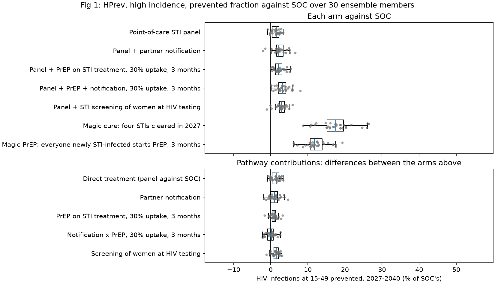

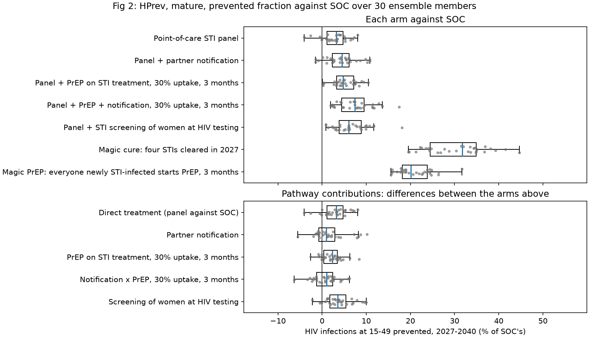

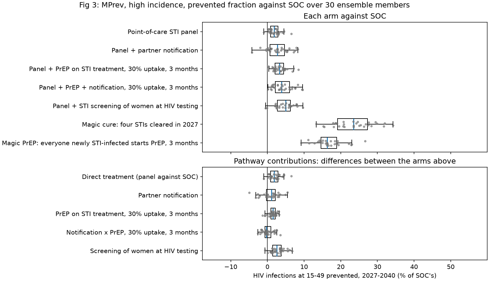

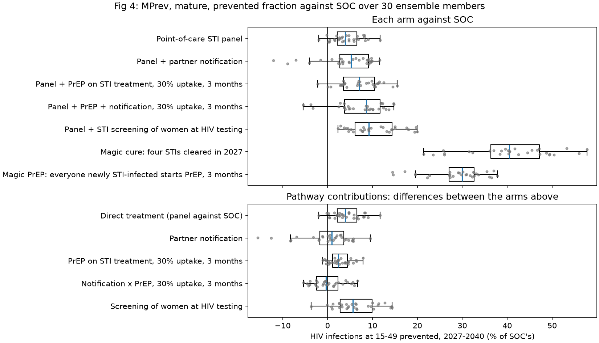

Figs 5-8 give the same contrasts as HIV infections at 15-49 averted over 2027-2040 against
SOC, in agents. Per-member values are in one pair of CSVs per setting, such as
`outputs/infections_averted_zimbabwe_mature.csv` and
`outputs/pathway_components_averted_zimbabwe_mature.csv`.

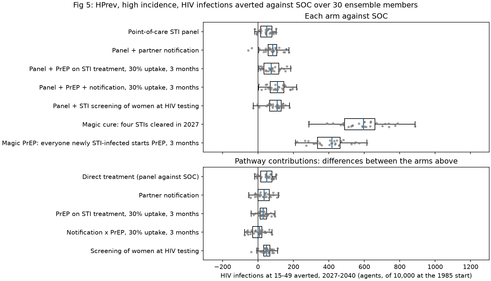

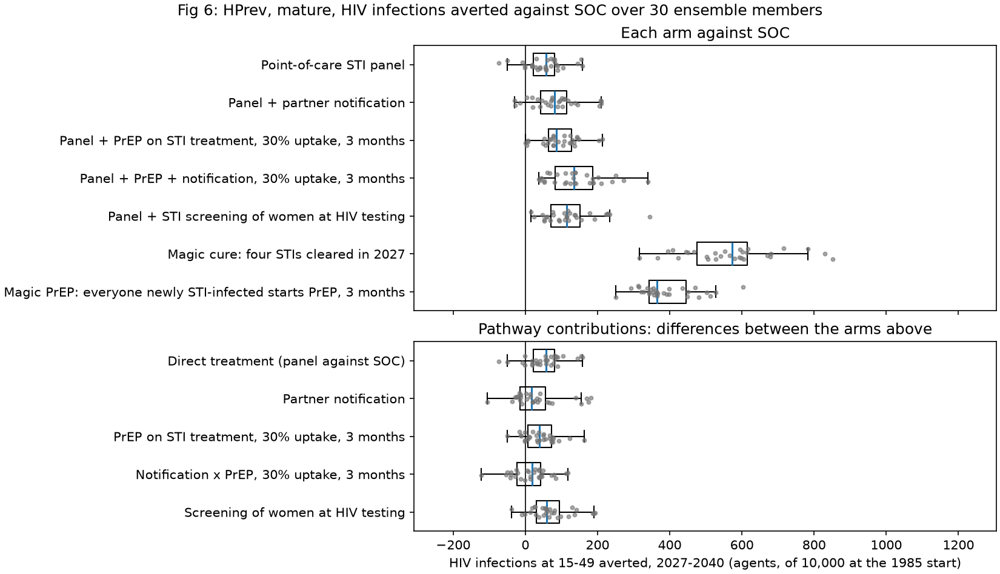

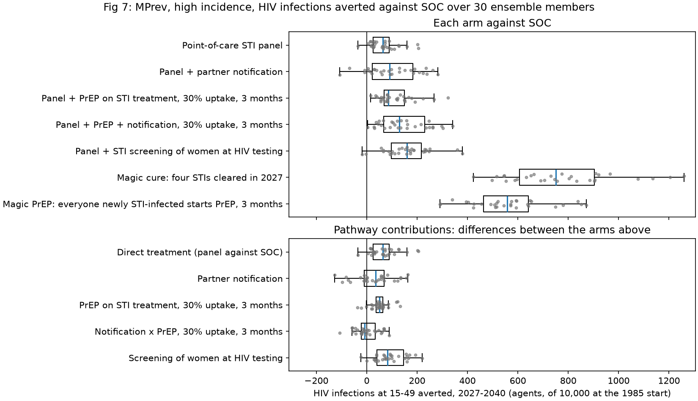

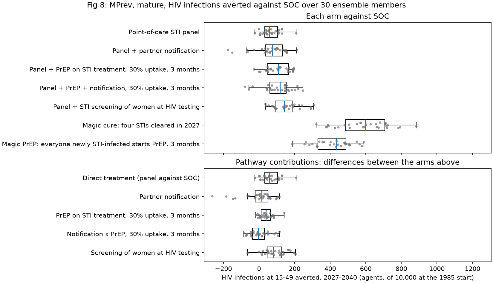

## Observations

1. All 960 stage 1 simulations finished on zebra at 80 workers, at 200-350 s each (median
   237 s). Each setting has a pair of CSVs in `outputs/` with per-member prevented fractions
   and pathway contributions, such as `outputs/prevented_fractions_zimbabwe_mature.csv` and
   `outputs/pathway_components_zimbabwe_mature.csv`.

2. The settings differ in how many infections each contrast is measured on. SOC's HIV
   infections at 15-49 over 2027-2040 per member, median (range) in agents: 3,349
   (2,296-4,623) HPrev high-incidence, 1,858 (1,603-2,325) HPrev mature, 3,189
   (2,255-4,496) MPrev high-incidence, 1,540 (959-1,959) MPrev mature. SOC's 2026
   HIV prevalence at 15-49 spans 22.1-27.7% in the two HPrev settings and 12.0-17.8% in
   the two MPrev settings.

3. Partner notification and the notification x PrEP interaction straddle zero in every
   setting. In MPrev mature, members 0020, 0037 and 0039 put notification's contribution at
   -8.3%, -12.6% and -15.5%. In 0037 and 0039 the notification arm has more HIV infections
   at 15-49 over 2027-2040 than SOC: 1,640 against 1,463 and 1,846 against 1,695. Not
   checked further: each member runs one seed, and 001-quick found seed noise of about 50
   HIV infections at 15-49 over 2027-2040 per Zimbabwe draw.

4. Magic PrEP starts about nine times as many PrEP courses as STI-triggered PrEP. Median
   per member over 2027-2040, in agents:

   | Setting | STI-triggered PrEP starts | Magic PrEP starts | Infections averted per 1,000 starts, STI-triggered (against the panel) | Infections averted per 1,000 starts, Magic PrEP (against SOC) |
   |---|---|---|---|---|
   | HPrev, high incidence | 2,360 | 22,735 | 14.6 | 18.0 |
   | HPrev, mature | 3,594 | 30,347 | 12.2 | 12.9 |
   | MPrev, high incidence | 3,194 | 31,666 | 14.2 | 17.1 |
   | MPrev, mature | 5,088 | 43,776 | 8.4 | 9.8 |

   Magic PrEP's prevented fraction is above the contribution of PrEP offered on STI
   treatment in all 30 members of every setting, which passes the README's check on the
   new eligibility rule. sti.Prep's `new_prep` and `n_on_prep` results are scaled to the
   country population (`pop_scale` 70.6 for HPrev, 868.7 for MPrev) and are divided by it
   here. `run.py` stores them unscaled.

5. The Magic cure's 17.5-40.5% (setting medians) is above the 3-17% attributable ceiling
   for a mature epidemic in the [STI-HIV cofactor synthesis](../../../docs/pages/sti-hiv-cofactor.md)
   in all four settings, as 001-quick's 40.0% was. MPrev mature here gives 40.5%,
   against 001-quick's 40.0% on six Zimbabwe draws.

6. The setting scales every arm by close to the same factor, the Magic cure's prevented
   fraction. Dividing each member's prevented fraction by its own Magic cure prevented
   fraction removes most of the difference between settings (Fig 9,
   `ratio_to_magic_cure.py`). The table gives the proportion of each quantity's variance
   across all 120 members that setting accounts for (eta squared), and the ratio's median
   over each setting's 30 members:

   | Arm | Setting's share of variance, prevented fraction | Setting's share of variance, ratio to Magic cure | Median ratio: HPrev high incidence, HPrev mature, MPrev high incidence, MPrev mature |
   |---|---|---|---|
   | Point-of-care STI panel | 0.19 | 0.01 | 0.10, 0.10, 0.07, 0.09 |
   | Panel + partner notification | 0.06 | 0.02 | 0.12, 0.14, 0.11, 0.13 |
   | Panel + PrEP offered on STI treatment | 0.29 | 0.03 | 0.13, 0.15, 0.14, 0.17 |
   | Panel + PrEP + notification | 0.20 | 0.08 | 0.18, 0.22, 0.17, 0.20 |
   | Panel + STI screening of women at HIV testing | 0.40 | 0.13 | 0.16, 0.22, 0.22, 0.25 |
   | Magic PrEP | 0.65 | 0.01 | 0.70, 0.69, 0.72, 0.71 |

   Screening women at HIV testing keeps the most dependence on setting after the division,
   with its median ratio lowest in HPrev high incidence. Per-member ratios are in
   `outputs/ratio_to_magic_cure_per_member.csv`.

   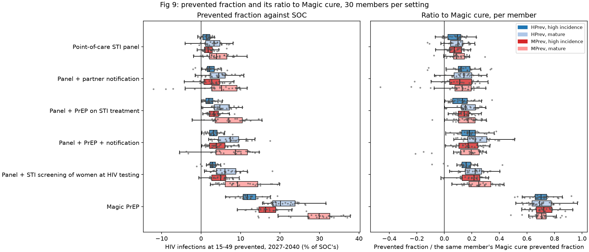

## Stage 2

In both STI-triggered PrEP arms, stage 2 crosses uptake (`prep.coverage` at 0.10, 0.30
and 0.90) with course length (`prep.dur_months` at 3 and 6), and it adds Magic PrEP at
`prep.dur_months` 6. All 1,320 stage 2 simulations finished on zebra at 80 workers, with
no failures, on the same members and seeds as stage 1. Figs 10-17 show all 18 arms against
SOC, the four settings on one axis per measure: Figs 10-13 as prevented fractions, Figs
14-17 as HIV infections averted in agents.

PrEP's contribution rises with uptake in every setting, and 6-month courses prevent more
than 3-month ones at each uptake. PrEP offered on STI treatment, against the panel alone,
as the median over 30 members of the percentage of SOC's HIV infections at 15-49
prevented over 2027-2040:

| PrEP on STI treatment | HPrev, high incidence | HPrev, mature | MPrev, high incidence | MPrev, mature |
|---|---|---|---|---|
| 10% uptake, 3 months | 0.2 | 0.4 | 0.4 | 0.9 |
| 30% uptake, 3 months | 0.8 | 2.3 | 1.5 | 2.4 |
| 90% uptake, 3 months | 3.3 | 6.2 | 4.9 | 9.7 |
| 10% uptake, 6 months | 0.3 | 0.5 | 0.8 | 1.4 |
| 30% uptake, 6 months | 1.6 | 3.5 | 2.6 | 4.5 |
| 90% uptake, 6 months | 6.0 | 10.7 | 7.8 | 15.4 |

The full package (panel, PrEP on STI treatment and partner notification) at 90% uptake and
6-month courses prevents 7.9% (HPrev high incidence), 17.5% (HPrev mature), 12.0% (MPrev
high incidence) and 24.6% (MPrev mature) of SOC's infections, against stage 1's 3.1%,
7.4%, 3.9% and 8.7% at 30% uptake and 3-month courses.

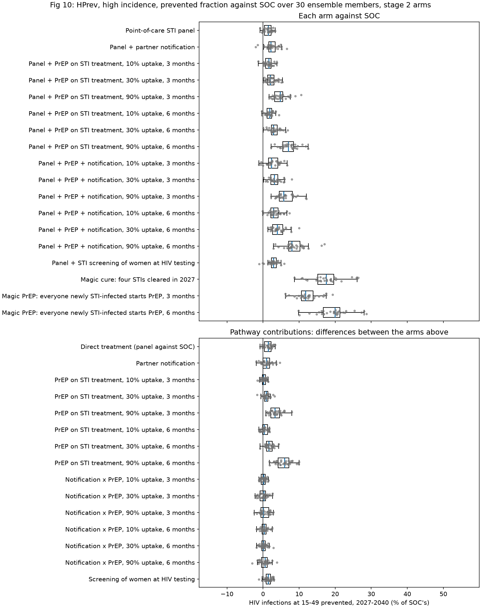

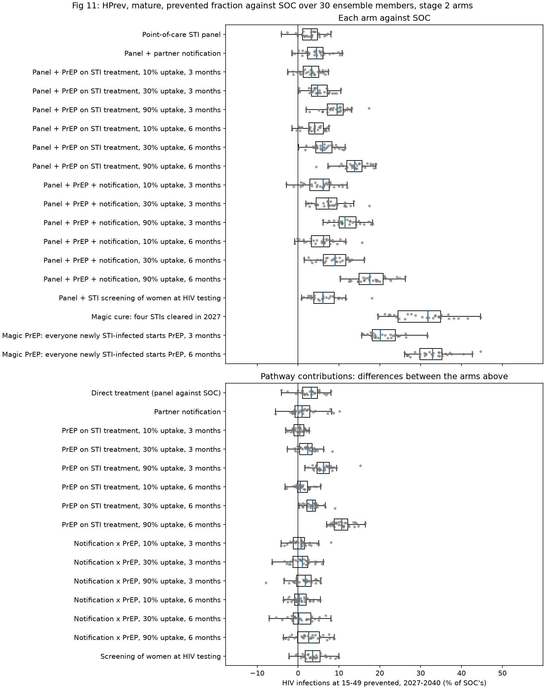

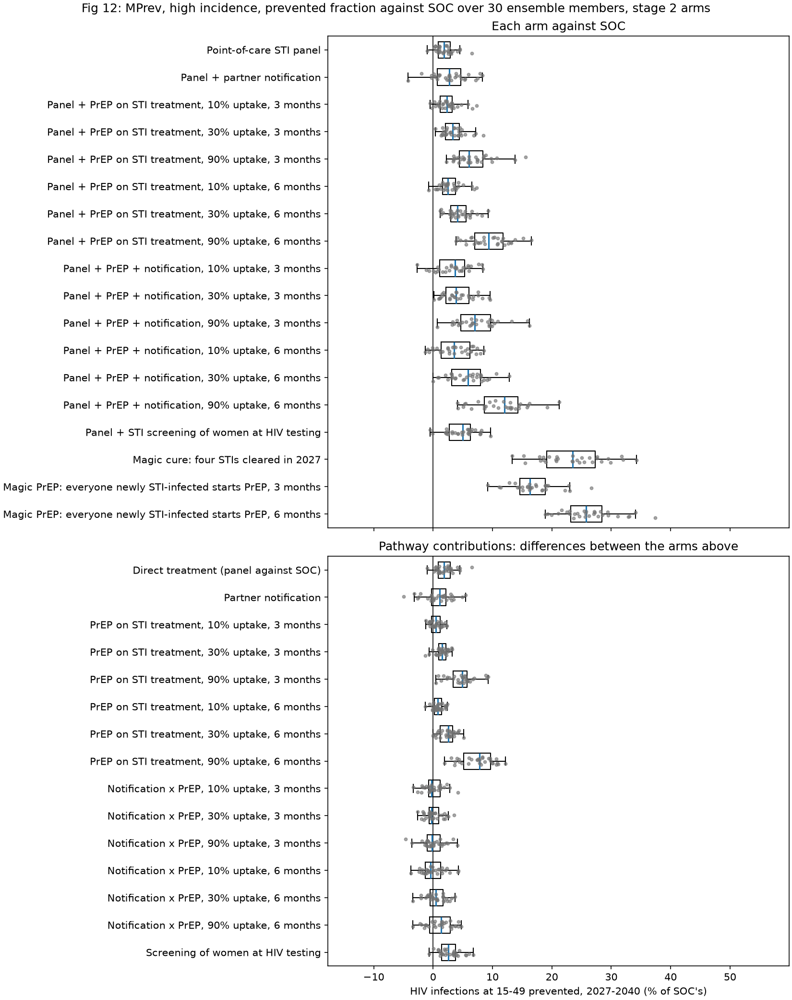

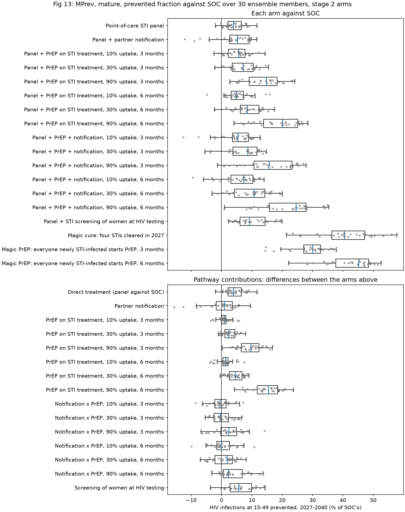

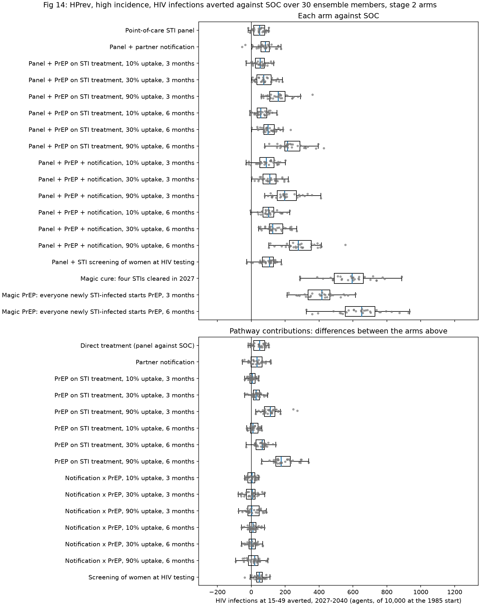

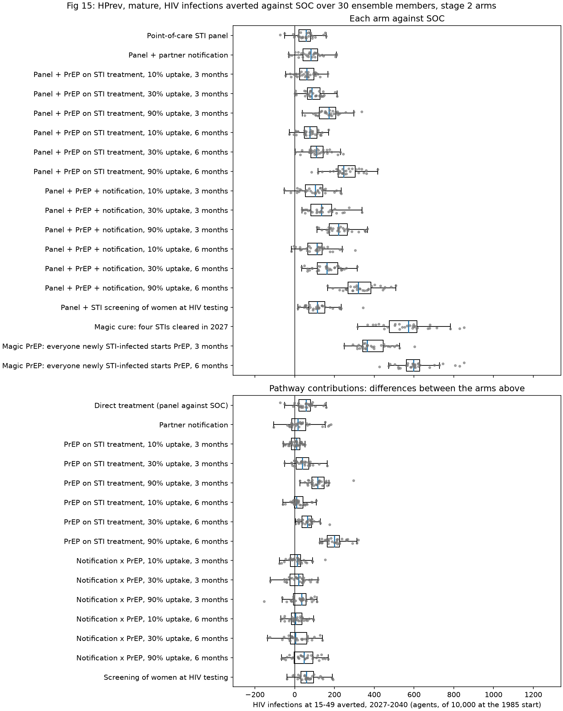

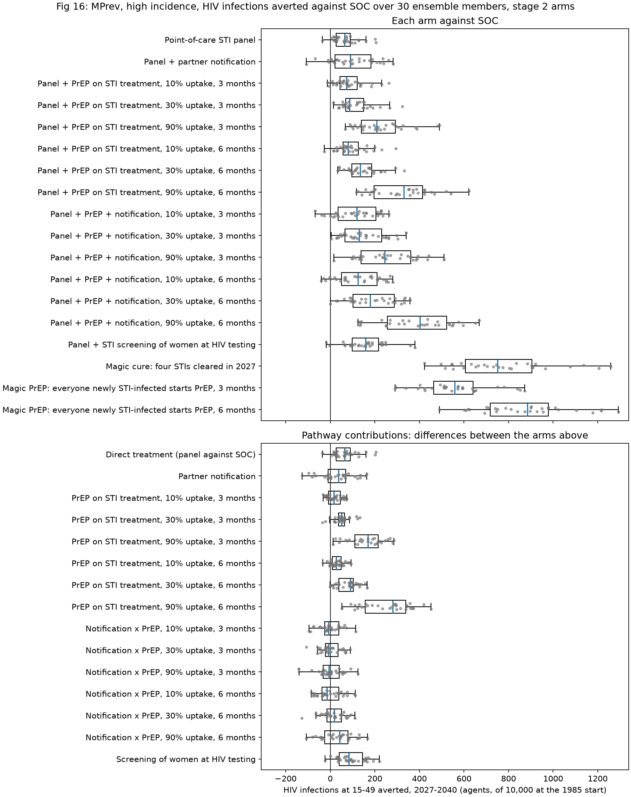

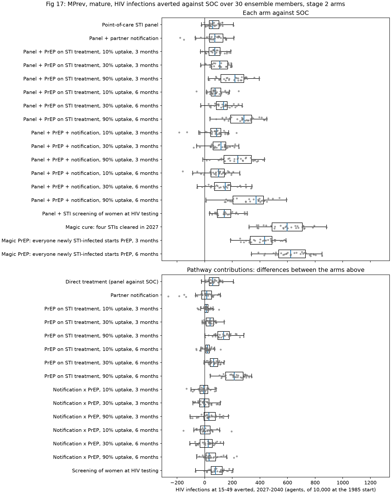

### Stage 2 observations

7. Doubling the course from 3 to 6 months multiplies the median contribution of PrEP on STI
   treatment by 1.20-1.93 across the 12 combinations of setting and uptake. The ratio has
   no consistent order by uptake: at 90% uptake it is 1.83 (HPrev high incidence), 1.71
   (HPrev mature), 1.59 (MPrev high incidence) and 1.59 (MPrev mature).

8. Magic PrEP with 6-month courses prevents a median 19.9% (HPrev high incidence), 32.8%
   (HPrev mature), 25.7% (MPrev high incidence) and 45.1% (MPrev mature) of SOC's
   infections, above the Magic cure's 17.5%, 31.8%, 23.5% and 40.5%. It exceeds the Magic
   cure in 27, 21, 27 and 20 of each setting's 30 members. PrEP lowers HIV susceptibility
   at every partnership whether or not an STI is present, so the Magic cure, which removes
   only the STI cofactor, does not bound it.

9. The notification x PrEP interaction stays small at every uptake and course length. Its
   setting medians run from -0.5% (MPrev mature, 10% uptake, 3 months) to 2.5% (HPrev
   mature, 90% uptake, 6 months), and it is largest at 90% uptake in all four settings.

## Next

- Check, in the model's cofactor values, why the Magic cure prevents above the cofactor
  synthesis's 3-17% ceiling in every setting (open since 001-quick).
- Run several seeds on the MPrev mature members where notification prevents below -8%,
  to tell seed noise from a notification effect.
