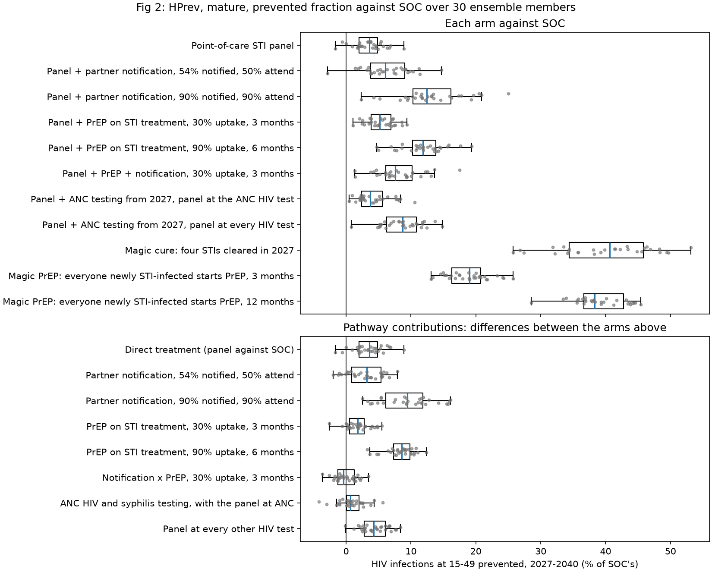
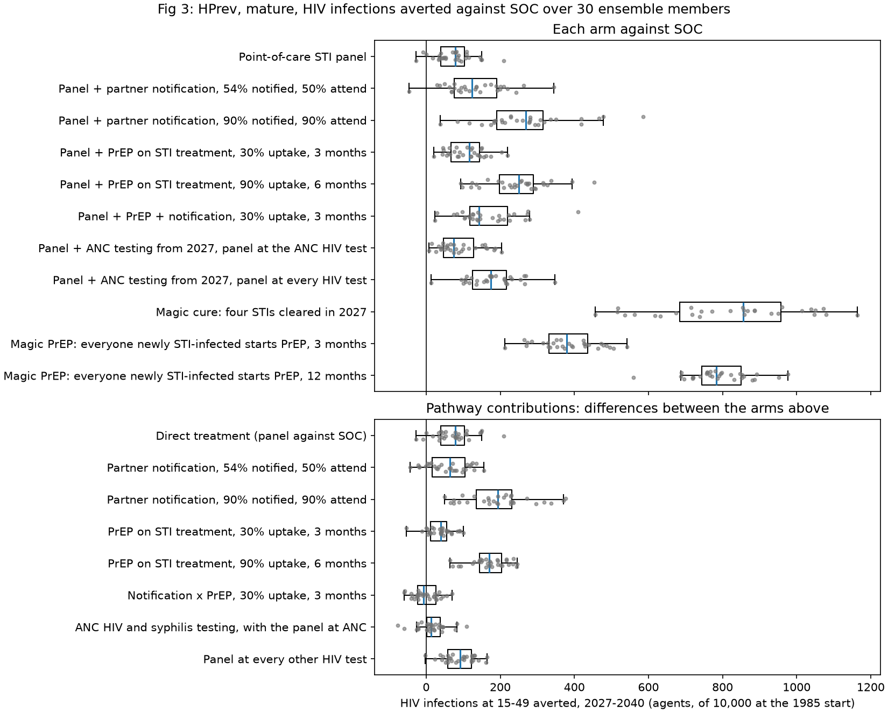
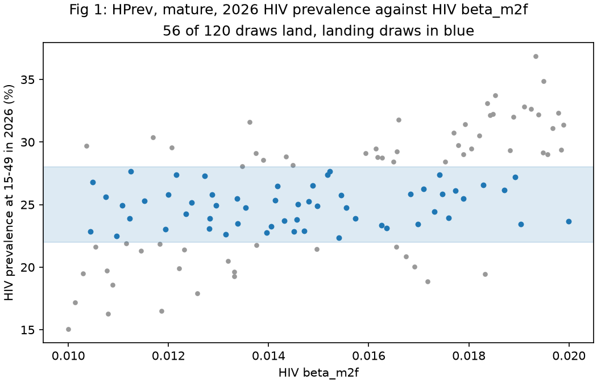

# Exp 45: HPrev mature arms under Barker 2022 cofactors, with ANC testing as an arm

**Date:** 2026-11-19.

**Question.** How much of SOC's HIV infections at 15-49 over 2027-2040 does each arm
prevent in the HPrev mature setting when the HIV acquisition cofactors are
[Barker 2022](../../../docs/pages/barker-2022-hiv-risk-nonviral-stis-meta-analysis.md)'s
pooled risk ratios for women, and ANC testing is an intervention from 2027 rather than
a baseline service? [44](../44_ensemble_prevented_fractions/SUMMARY.md) found every arm's
prevented fraction scaling with the Magic cure's, which the cofactors set. Every run here
takes `connectors.hiv_ng.rel_sus_hiv_ng` = 2.81, `hiv_ct.rel_sus_hiv_ct` = 1.49,
`hiv_tv.rel_sus_hiv_tv` = 1.54 and `hiv_syph.rel_sus_hiv_syph` = 1.67 in both sexes (44 ran
1.2, 1.2, 1.5 and 2.67 for the same four), with ANC HIV testing and ANC syphilis screening
off (`anc.start` = inf) except where an arm starts them in 2027. Stage 1 redrew the
setting: 120 Eswatini draws from 43's mature-cell ranges, run as SOC on 10,000 agents and
one seed each. Stage 2 ran eleven arms on the 30 members. Magic PrEP at 12-month courses
was added after the first ten arms had run.

**Result.** The Magic cure prevents a median 40.6% of SOC's infections, against 31.8% in
44's HPrev mature setting under the old cofactors. The arms built on the point-of-care
panel prevent 3.6-12.4% (medians), and Magic PrEP prevents 19.0% at 3-month courses and
38.3% at 12-month courses. Switching on ANC HIV testing and syphilis screening in 2027,
with the panel offered at the ANC HIV test, adds a median 0.6 percentage points over the
panel alone. Offering the panel at every other HIV test as well adds 4.3.

Prevented fraction of SOC's HIV infections at 15-49 over 2027-2040, in percent, and HIV
infections at 15-49 averted over 2027-2040 against SOC, in agents, over 30 members:

| Arm | Prevented fraction, median (IQR) | Prevented fraction, range | Infections averted, median (IQR) |
|---|---|---|---|
| Point-of-care STI panel | 3.6 (2.0 to 4.9) | -1.7 to 8.9 | 79 (40 to 104) |
| Panel + partner notification, 54% notified, 50% attend | 6.1 (3.8 to 9.0) | -2.8 to 14.7 | 124 (76 to 191) |
| Panel + partner notification, 90% notified, 90% attend | 12.4 (10.3 to 16.1) | 2.3 to 25.0 | 270 (191 to 316) |
| Panel + PrEP on STI treatment, 30% uptake, 3 months | 5.2 (3.8 to 6.9) | 1.1 to 9.4 | 116 (67 to 145) |
| Panel + PrEP on STI treatment, 90% uptake, 6 months | 11.9 (10.2 to 13.9) | 4.7 to 19.3 | 251 (198 to 290) |
| Panel + PrEP + notification, 30% uptake, 3 months, 54% notified, 50% attend | 7.6 (6.1 to 10.2) | 1.3 to 17.5 | 142 (117 to 220) |
| ANC arm: panel + ANC testing from 2027, panel at the ANC HIV test | 3.7 (2.4 to 5.6) | 0.4 to 10.6 | 74 (47 to 128) |
| ANC + HIV testing arm: panel + ANC testing from 2027, panel at every HIV test | 8.7 (6.3 to 10.8) | 0.8 to 14.9 | 175 (126 to 217) |
| Magic cure: four STIs cleared in 2027 | 40.6 (34.4 to 45.9) | 25.7 to 53.1 | 856 (684 to 958) |
| Magic PrEP, 3-month courses | 19.0 (16.3 to 20.7) | 13.1 to 25.7 | 380 (331 to 437) |
| Magic PrEP, 12-month courses | 38.3 (36.7 to 42.8) | 28.6 to 45.4 | 784 (744 to 851) |

Pathway contributions, as differences between the arms' prevented fractions, in percentage
points over 30 members:

| Pathway | Median (IQR) | Range |
|---|---|---|
| Direct treatment (panel against SOC) | 3.6 (2.0 to 4.9) | -1.7 to 8.9 |
| Partner notification, 54% notified, 50% attend | 3.2 (0.8 to 5.4) | -2.0 to 7.9 |
| Partner notification, 90% notified, 90% attend | 9.4 (6.1 to 11.9) | 2.5 to 16.1 |
| PrEP on STI treatment, 30% uptake, 3 months | 1.8 (0.5 to 2.8) | -2.6 to 5.5 |
| PrEP on STI treatment, 90% uptake, 6 months | 8.6 (7.3 to 9.9) | 3.3 to 12.4 |
| Notification x PrEP, 30% uptake, 3 months | -0.4 (-1.3 to 1.2) | -3.7 to 3.5 |
| ANC HIV and syphilis testing, with the panel at ANC (ANC arm against the panel) | 0.6 (0.1 to 2.0) | -4.2 to 5.7 |
| Panel at every other HIV test (ANC + HIV testing arm against the ANC arm) | 4.3 (2.8 to 6.1) | -0.1 to 8.4 |

## Observations

1. 56 of the 120 stage 1 draws land within 3 points of the setting's 25% target for 2026
   HIV prevalence at 15-49, the proportion 43 landed (0.47). Landing draws spread across the
   whole `hiv_beta_m2f` range, 0.010-0.020 (Fig 1). 2026 HIV prevalence at 15-49 spans
   15.1-36.8% across the 120 draws and 22.4-27.6% across the 30 members. SOC's HIV infections at 15-49 over 2027-2040
   per member are a median 2,041 agents (range 1,575-2,399), against 44's 1,858
   (1,603-2,325) in the same setting. All 450 simulations finished on zebra at 160 workers
   with no failures, each taking 240-521 s of run time (median 368 s).

   

2. Both wiring checks in the README pass. The ANC + HIV testing arm's prevented fraction is
   above the ANC arm's in 29 of 30 members, and 0.1 percentage points below it in the
   other. Magic PrEP at 3-month courses is above the contribution of 30%-uptake PrEP on STI
   treatment in all 30 members, by 7.6-24.6 percentage points.

3. The arms' ratio to the Magic cure moves less evenly than 44 found across settings. Median
   over members of each arm's prevented fraction divided by the same member's Magic cure
   prevented fraction, exp 45 against 44's HPrev mature setting: panel 0.09 against 0.10,
   panel + notification at 54% and 50% 0.16 against 0.14, panel + PrEP at 30% uptake and
   3-month courses 0.14 against 0.15, the same with notification 0.22 against 0.22, panel +
   PrEP at 90% uptake and 6-month courses 0.30 against 0.46, Magic PrEP at 3-month courses
   0.46 against 0.69. The 90%-uptake PrEP arm prevents 11.9% here against 13.8% in 44, and
   Magic PrEP at 3-month courses 19.0% against 20.1%, while the Magic cure rises from 31.8%
   to 40.6%.

4. Magic PrEP at 12-month courses prevents twice what 3-month courses do (median 38.3%
   against 19.0%) from fewer courses started: a median 19,600 against 25,500 per member over
   2027-2040, in agents. PrEP on STI treatment starts 2,700 courses at 30% uptake and 3-month
   courses and 7,300 at 90% uptake and 6-month courses. sti.Prep's `new_prep` results are
   scaled to Eswatini's population and are divided here by `pop_scale` 70.6.

5. ANC testing reaches few asymptomatic infections. STI infections treated without symptoms
   over 2027-2040, all four STIs, median per member in agents: 5,227 with the panel alone,
   7,304 in the ANC arm, 11,427 in the ANC + HIV testing arm, 11,534 with notification at
   54% and 50%, and 16,688 with notification at 90% and 90%. The ANC arm's contribution also
   includes ANC HIV testing's own effect, through diagnosis and ART, which no arm separates.

6. The Magic cure's 40.6% is further above the 3-17% attributable ceiling for a mature
   epidemic in the [STI-HIV cofactor synthesis](../../../docs/pages/sti-hiv-cofactor.md)
   than 44's 31.8%.

## Next

- Which cofactor change lowers the ratio to the Magic cure of PrEP on STI treatment at 90%
  uptake and 6-month courses (0.46 in 44, 0.30 here) and of Magic PrEP at 3-month courses
  (0.69 to 0.46), while the panel's and notification's ratios stay put?
- 44's open thread on the Magic cure exceeding the cofactor synthesis's 3-17% ceiling now
  applies at 40.6%.
