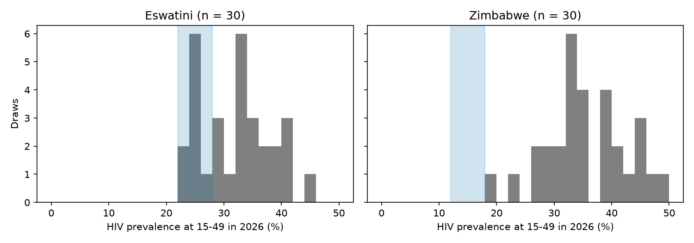
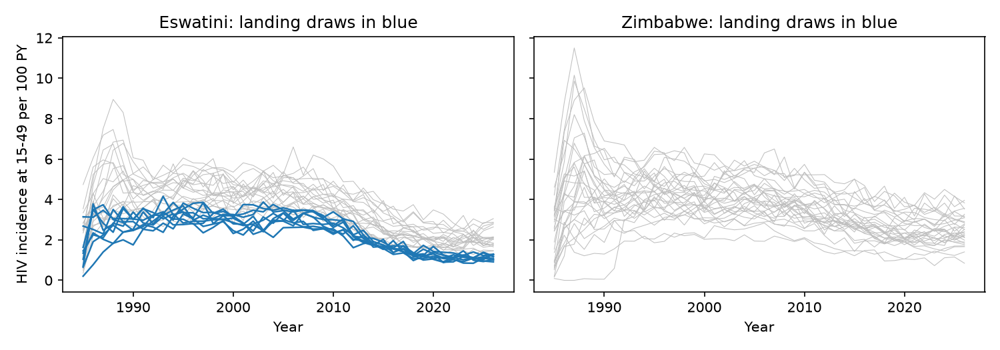

# Exp 38: Explore network, HIV and STI parameters for the four settings

**Date:** 2026-11-17.

**Question.** Which of 13 network, HIV and STI parameters move HIV prevalence at ages
15-49 in 2026 and the year HIV incidence peaks, and what fraction of each country's
draws lands in each setting's cell? The [README](README.md) planned a 60-draw local pilot
to size a larger batch. This approach closes on the pilot, because the pilot showed the
ranges cannot fill three of the four cells.

**Result.** 9 of 30 Eswatini draws land within 3 points of 25%, and none of 30 Zimbabwe
draws comes within 3 points of 15%: the lowest reaches 18.9% and the median 34%. All 9
landing draws are mature epidemics (HIV incidence at 15-49 peaking between 1986 and 2003,
and 2026 HIV prevalence-to-incidence ratios of 19-26 years), so neither expanding cell has
a draw. Every draw carries 2026 syphilis prevalence at 15-49 of 25-45%, far above any
measured population.

## Observations

1. Run time at 10,000 agents, 1985 to the end of 2026, is 163 s per simulation on average
   (123-179 s). The 60 ran in 10.5 minutes on 18 local workers, none failing.
2. The issue's batch rule (N ≈ 30 / p) gives about 100 Eswatini draws for the mature high
   cell. For Zimbabwe and both expanding cells p = 0 of 30, so the rule gives no N. If the
   true p were 10%, 30 draws would all miss 4% of the time, so a Zimbabwe batch on these
   ranges would need more than 300 draws.
3. All 30 Zimbabwe draws overshoot the medium cell, and 3 of them (22-28%) fall in the high
   cell that only Eswatini fills.
4. HIV `beta_m2f` drives 2026 prevalence (rank correlation 0.77 over the 60 draws),
   followed by `prop_m0` (-0.47) and `prop_f2` (0.30). The bottom of the HIV beta range,
   0.0086, still gives 19% in Zimbabwe.
5. `rel_init_prev` barely moves 2026 prevalence (0.05). It moves the peak earlier (-0.36),
   as does HIV `beta_m2f` (-0.49).
6. HIV incidence at 15-49 takes off within two to three years of 1985 in nearly every
   draw, reaching up to 11.5 per 100 person-years in a Zimbabwe draw in 1987. Across the 9
   landing Eswatini draws, HIV incidence at 15-49 stays between 1.8 and 4.2 per 100 person-years
   in every year from 1990 to 2010, and is 0.9-1.3 per 100 person-years in 2026.
7. Each STI's 2026 prevalence follows its own beta (gonorrhoea 0.98, chlamydia 0.89,
   trichomoniasis 0.81, syphilis 0.68). Over all draws, prevalence at 15-49 runs: syphilis
   (any stage) 24.7-44.5%, RPR-positive syphilis 20.5-35.8%, chlamydia 3.1-35.0%,
   trichomoniasis 9.9-50.1%, gonorrhoea 0-9.9%. The landing draws' medians are 35.1%,
   28.8%, 21.8%, 36.1% and 2.2%.
8. Syphilis stays above 24% even at the lowest syphilis beta in the range (0.097), so its
   floor comes from somewhere other than the explored range.

## Next

Issue 38 stays open, and the next approach to it asks the same question on revised
ranges: which HIV `beta_m2f` range lets Zimbabwe draws reach 15% in 2026, and can any
combination of seeding and network delay the incidence peak enough to produce an
expanding epidemic?
