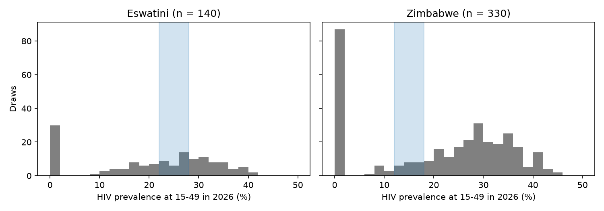
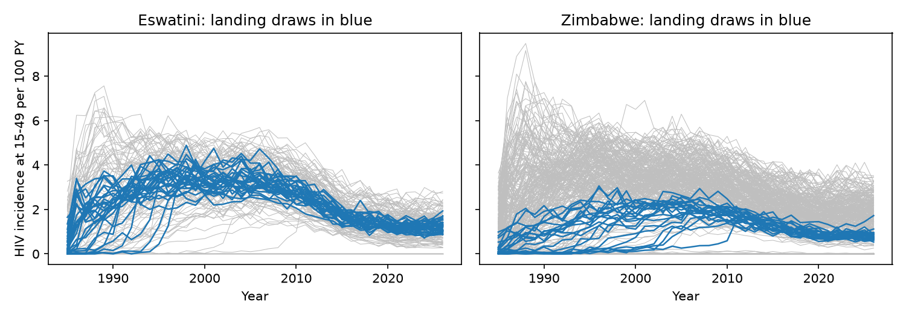
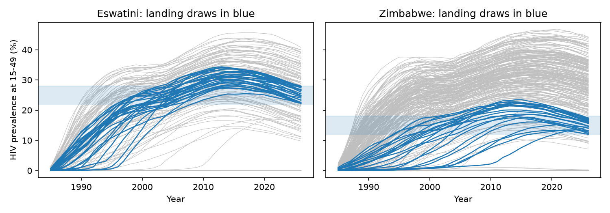

# Exp 38.2: Explore network, HIV and STI parameters for the four settings, lower HIV ranges

**Date:** 2026-11-18.

**Question.** Which of 13 network, HIV and STI parameters move HIV prevalence at ages
15-49 in 2026 and the year HIV incidence peaks, and what fraction of each country's draws
lands in each setting's cell? The [README](README.md) repeats
[38.1](../38.1_explore_parameters/SUMMARY.md), whose pilot put no Zimbabwe draw in the
medium cell, with HIV `beta_m2f` lowered to 0.003-0.025 and `rel_init_prev` to 0.01-1.5
on a log scale. A 60-draw local pilot sized a 410-draw batch on zebra.

**Result.** Both mature cells filled close to the planned 30 landing draws: 29 of 140
Eswatini draws land within 3 points of 25%, and 22 of 330 Zimbabwe draws within 3 points
of 15%. Neither expanding cell has a clear draw. All 51 landing draws' HIV incidence at
15-49 peaks by 2017, 50 of them by 2011. In 117 of the 470 draws, mostly those with
`rel_init_prev` below 0.03, HIV prevalence at 15-49 in 2026 is under 1%.

## Observations

1. Run time per simulation at 10,000 agents, 1985 to the end of 2026, was 166 s on
   average (128-182 s) in the local pilot and 345 s (251-388 s) on zebra. Zebra ran 40
   workers beside another user's 120-core job. The 410 batch simulations took 63 minutes
   there, and none of the 470 failed.
2. The landing fraction fell from pilot to batch in both countries. Eswatini went from
   8 of 30 to 21 of 110 (19%) and Zimbabwe from 3 of 30 to 19 of 300 (6.3%). The batch
   sized for 30 Zimbabwe landing draws gave 22.
3. Zimbabwe still overshoots. Its median 2026 prevalence is 25.4%, 211 of 330 draws are
   above 18%, and 49 fall in the high cell (22-28%) that only Eswatini fills.
4. HIV dies out when the seed is small. The proportion of draws with 2026 prevalence
   under 1%, by `rel_init_prev`: 78 of 109 at 0.01-0.03, 29 of 107 at 0.03-0.1, 10 of
   104 at 0.1-0.3, and 0 of 150 at 0.3-1.5. These are the 30 Eswatini and 87 Zimbabwe
   draws in the bar at 0% in the prevalence figure.
5. Among the 353 draws with 2026 prevalence of at least 1%, HIV `beta_m2f` drives 2026
   prevalence (rank correlation 0.85). The next strongest are `prop_m0` (-0.19),
   chlamydia `beta_m2f` (0.16) and `prop_m2` (0.15). `rel_init_prev` has a correlation of
   0.07 there and 0.50 over all 470 draws, because it decides whether the epidemic takes
   off but barely changes where a surviving epidemic ends up.
6. Over the same 353 draws, the incidence peak comes earlier with higher HIV `beta_m2f`
   (rank correlation -0.64), higher `rel_init_prev` (rank correlation -0.27) and higher `f1_conc` (-0.19).
   Six of the 353 peak in 2010 or later.
7. Eswatini's landing draws peak between 1989 and 2006, with ratios of 2026 HIV
   prevalence to 2026 HIV incidence, both at 15-49, of 14.3-26.0 years. Zimbabwe's peak between 1996 and 2017, with ratios of
   8.4-25.7 years. The three Zimbabwe landing draws peaking in 2010, 2011 and 2017 all
   have `rel_init_prev` of 0.031-0.036. The 2017 draw (`batch-zimbabwe-0255`) has
   incidence of 0.3 per 100 person-years in 2000, 1.74 in 2017, 1.45 in 2020 and 1.72 in
   2026, and a 2026 ratio of 8.4 years. The [settings
   decision](../../../docs/pages/settings-prevalence-by-phase.md) quotes prevalence-to-incidence
   ratios of 4.6 years for Mwanza's expanding epidemic and 10-15 years for the mature trial
   sites.
8. HIV incidence at 15-49 in 2026 is 0.87-1.94 per 100 person-years across Eswatini's
   landing draws and 0.53-1.72 across Zimbabwe's. In every landing draw it falls between
   about 2010 and 2016 (incidence figure). In 8 of the 51, mean incidence over 2024-2026
   exceeds the 2018-2020 mean, by at most 11% of that mean.
9. HIV prevalence at 15-49 peaks between 2012 and 2017 in Eswatini's landing draws (at
   25.5-34.4%) and between 2011 and 2026 in Zimbabwe's (at 13.3-23.5%). From 2020 to 2026
   it falls in all 29 Eswatini landing draws, by 1.7-5.4 percentage points, and in 20 of
   the 22 Zimbabwe landing draws. It rises in the other two, by up to 2.7 percentage
   points (prevalence trajectory figure).
10. Eight draws with 2026 prevalence of at least 1% start their epidemic in 2000 or later,
    taking the start as the first year HIV incidence at 15-49 reaches 0.5 per 100
    person-years. Their 2026 prevalence is 9.6-22.2%, with HIV `beta_m2f` of
    0.0035-0.0187. Five are Zimbabwe landing draws, at `beta_m2f` 0.0062-0.0140. None
    reaches 25%, and the highest, 22.2%, has `beta_m2f` 0.0186. No draw with `beta_m2f`
    above 0.019 starts late, because at that transmission even the smallest seed takes
    off within a few years of 1985, so these results don't show where a late-starting
    epidemic reaches 25%.
11. The landing draws' HIV `beta_m2f` spans 0.0060-0.0206 in Eswatini and 0.0043-0.0140 in
   Zimbabwe.
12. 2026 STI prevalence at 15-49 over all draws: syphilis (any stage) 20.9-47.9%,
    RPR-positive syphilis 17.8-38.0%, chlamydia 1.9-35.5%, trichomoniasis 2.2-51.2%,
    gonorrhoea 0-11.4%. The landing draws' medians, in the same order, are 34.3%, 29.1%,
    23.2%, 37.1% and 3.1%. Syphilis keeps the floor 38.1 found (24.7% there, 20.9% here).

## Next

Issue 38 is answered: the mature cells' landing fractions and the parameters that drive
2026 prevalence and the peak year are measured, and these ranges produce no expanding
epidemic. Lowering the 1985 seed moved the latest HIV incidence peak among landing draws only from
2005 in 38.1 to 2017. The next experiment adds an HIV `seed_year`, introducing HIV in
a chosen year after 1985, to produce epidemics that are clearly expanding in 2026. About
130 more Zimbabwe draws, at the batch's landing fraction of 19 in 300, would bring the
medium mature cell to 30 landing draws.
