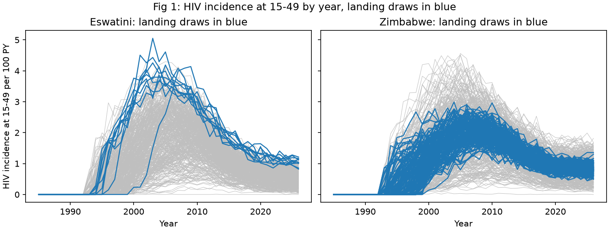
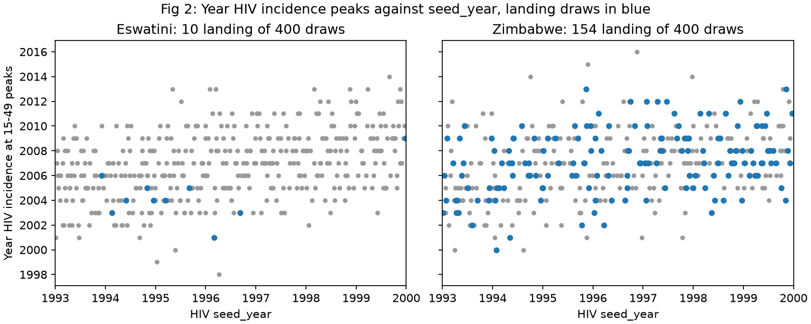
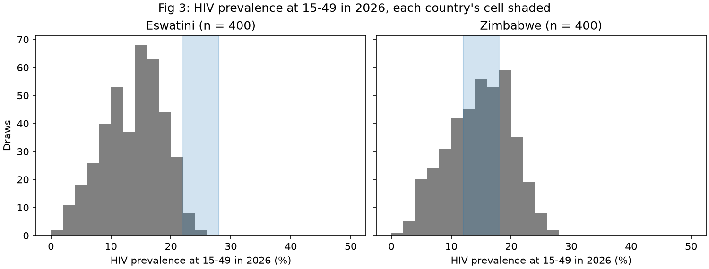
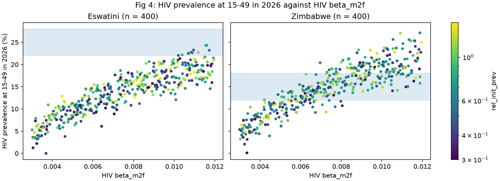
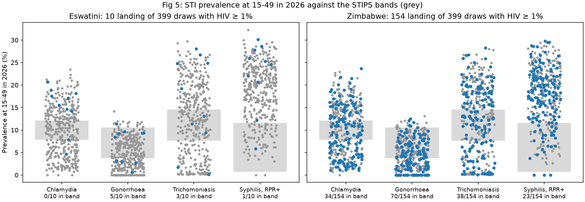
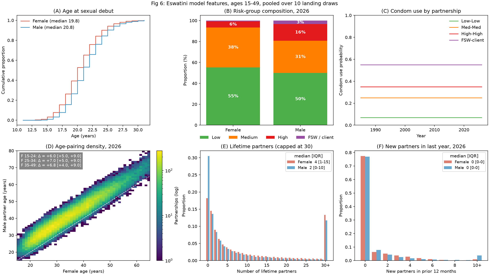
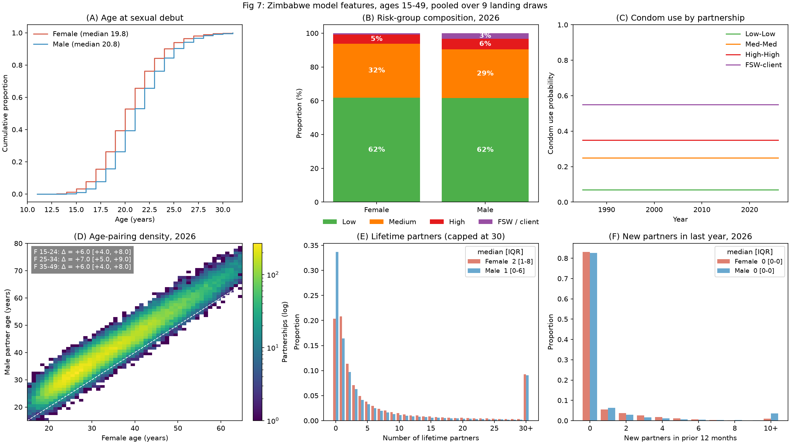
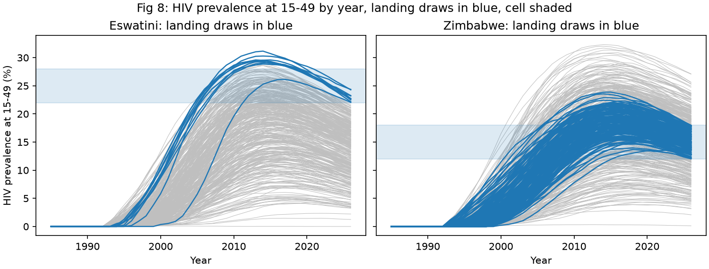

# Exp 38.3: Explore network, HIV and STI parameters for the four settings, later HIV seeding and lower STI ranges

**Date:** 2026-11-18.

**Question.** Which of 14 network, HIV and STI parameters move HIV prevalence at ages
15-49 in 2026 and the year HIV incidence peaks, what fraction of each country's draws
lands in each setting's cell, and how does the landing draws' 2026 curable-STI prevalence
compare with the STIPS bands? The [README](README.md) repeats
[38.2](../38.2_lower_hiv_beta_and_seed/SUMMARY.md) with HIV seeded in a year drawn over
1993-2000, `rel_init_prev` 0.3-1.5, HIV `beta_m2f` 0.003-0.012 for both countries, and
lower chlamydia, trichomoniasis and syphilis `beta_m2f` ranges. One zebra batch ran 400
draws per country.

**Result.** Seeding HIV 8-15 years later still gives no expanding epidemic. Incidence
peaks 3.6-19.2 years after `seed_year` (median 10.3), so every draw with HIV peaks in
1999-2016, and all 164 landing draws peak by 2013 and have falling prevalence from 2020
to 2026. Zimbabwe fills its mature cell, with 154 of 400 draws landing at 12-18% HIV
prevalence at 15-49 in 2026. Eswatini lands 10 of 400 at 22-28%, all at HIV `beta_m2f`
0.0102-0.0117, and its highest 2026 prevalence is 24.4%. The STI bands are now reachable: every infection has draws
inside its band, at `beta_m2f` 0.06-0.141 for chlamydia, 0.137-0.33 for gonorrhoea,
0.022-0.067 for trichomoniasis and 0.01-0.04 for syphilis.

## Observations

1. All 800 simulations finished. Run time at 10,000 agents, 1985 to the end of 2026, was
   211 s on average (200-226 s) on zebra with 80 workers and no other load. Two draws, one
   per country, had 2026 HIV prevalence under 1%, against 117 of 470 in 38.2.
2. A later seed moves the peak only part of the way. The median peak year among the 798
   draws with HIV is 2005 for `seed_year` 1993-1995, 2007 for 1995-1997, and 2008 for
   1997-1999 and 1999-2000. Rank correlation of peak year with `seed_year` is 0.38 in
   Eswatini and 0.32 in Zimbabwe; with HIV `beta_m2f` it is -0.58 and -0.45. Only one draw
   peaks in 2016 (`batch-zimbabwe-0053`, 8.2% prevalence in 2026), and the next latest
   peak in 2014-2015.
3. Landing draws' incidence in 2026 is 20-56% of its peak (median 36%). In 24 of the 164,
   mean incidence over 2024-2026 exceeds the 2018-2020 mean, by more than 10% in 5
   Zimbabwe draws (up to 36.7%), each from a 2018-2020 mean of 0.61-0.88 per 100
   person-years. HIV prevalence at 15-49 falls from 2020 to 2026 in all 164, by 0.6-5.2
   percentage points (Fig 8).
4. The ratio of 2026 prevalence to 2026 incidence, both at 15-49, is 19.5-27.0 years in
   Eswatini's landing draws and 13.0-28.4 in Zimbabwe's, against 8.4-26.0 across 38.2's
   landing draws.
5. HIV `beta_m2f` drives 2026 prevalence (rank correlation 0.89 in Eswatini, 0.88 in
   Zimbabwe over draws with HIV). The next strongest are trichomoniasis `beta_m2f` (0.22
   in both), `prop_m2` (0.15 Eswatini), `seed_year` (-0.15 Eswatini) and `prop_m0` (-0.17
   Zimbabwe).
6. Eswatini's median 2026 prevalence is 14.4%, and 390 of 400 draws are below 22%. By HIV
   `beta_m2f`, its median and highest 2026 prevalence are 8.6% and 14.8% at 0.003-0.006,
   13.8% and 18.6% at 0.006-0.008, 16.7% and 21.1% at 0.008-0.010, and 18.8% and 24.4% at
   0.010-0.012. Its 10 landing draws have `seed_year` 1993.9-2000.0 and peak in 2001-2009.
7. Zimbabwe's landing draws span the whole HIV `beta_m2f` range (0.0042-0.0119) and
   `seed_year` range (1993.0-2000.0), and peak in 2000-2013. Of its 400 draws, 123 are
   above 18% and 123 below 12%. Its highest 2026 prevalence is 27.1%.
8. STI prevalence in 2026 among landing draws, against the STIPS band (landing draws in
   band, median):

   | | Eswatini (10) | Zimbabwe (154) |
   |---|---|---|
   | Chlamydia, band 7.9-12.0% | 0, 16.3% | 34, 9.8% |
   | Gonorrhoea, band 3.8-10.5% | 5, 8.8% | 70, 3.8% |
   | Trichomoniasis, band 7.7-14.5% | 3, 16.1% | 38, 12.9% |
   | RPR-positive syphilis, band 0.8-11.5% | 1, 25.0% | 23, 18.1% |

   One landing draw, in Zimbabwe, has all four inside their bands.
9. Each STI's prevalence tracks its own `beta_m2f` (rank correlation 0.93 chlamydia,
   0.97 gonorrhoea, 0.94-0.96 trichomoniasis, 0.88-0.89 syphilis). Median 2026
   RPR-positive syphilis prevalence over draws with HIV is 8.0% at syphilis `beta_m2f`
   0.01-0.03, 14.3% at 0.03-0.05, 19.6% at 0.05-0.08 and 23.7% at 0.08-0.12, so 38.2's
   syphilis floor came from its range, which started at 0.097.
10. Figs 6 and 7 pool the 2026 network at 15-49 over the first 10 landing draws per
    country by draw ID, rerun on their batch seeds with the six-panel network summary.
    Nineteen reran to the same 2026 HIV prevalence as the batch, and `batch-zimbabwe-0015`
    did not and is left out. Median lifetime partners, sex-work partners included, are 4
    [IQR 1-15] for women and 2 [0-10] for men in Eswatini, and 2 [1-8] and 1 [0-6] in
    Zimbabwe, with 9-13% of each sex at 30 or more. The median age gap, man minus woman,
    is 6-7 years in every female age group in both countries. Median age at debut is 19.8
    years for women and 20.8 for men in both, since debut age is a fixed input. The high
    risk group holds 16% of Eswatini men against 6% of Zimbabwe men.

## Next

The exploration's three answers are in: landing fractions are 154 of 400 (Zimbabwe,
mature) and 10 of 400 (Eswatini, mature), with no expanding draw in either country; HIV
`beta_m2f` drives 2026 prevalence and, with `seed_year`, the peak year; and each STI
reaches its band at the `beta_m2f` values in the Result. No `seed_year` in 1993-2000
gives an expanding epidemic, and `seed_year` is not carried forward.

The next experiment gives each setting its own HIV `beta_m2f` range. Eswatini lands only
at 0.0102-0.0117, the top of the shared range, and its 2026 prevalence rises with
`beta_m2f` up to the range's edge (observation 6), so its range extends above 0.012.
Reduced ART scale-up in the high-incidence setting is a candidate for the same
experiment, to be settled when its issue is drafted.
