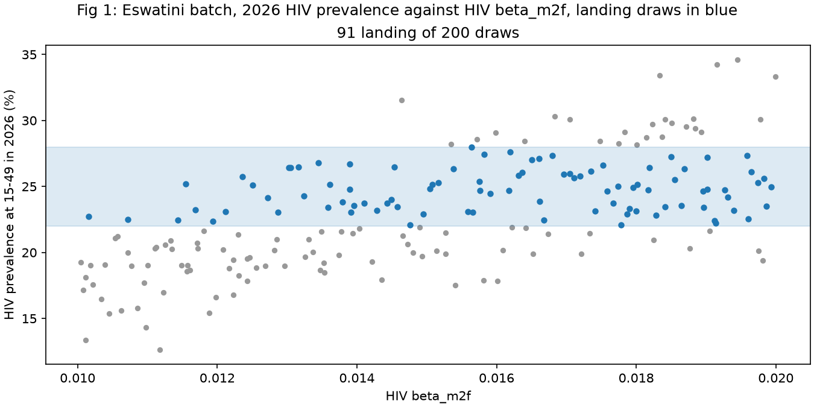
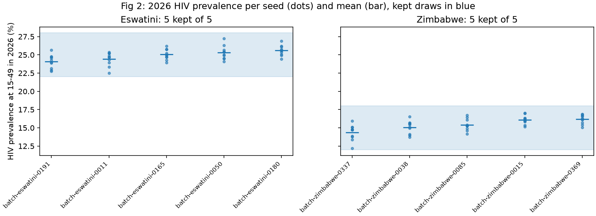
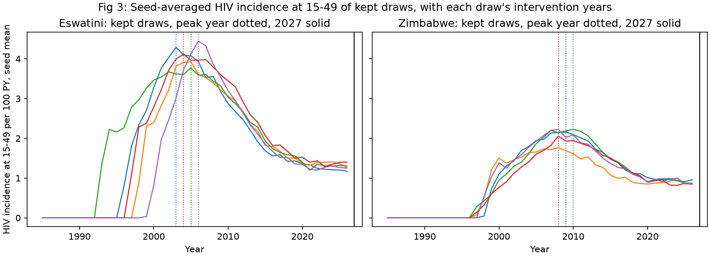

# Exp 40.1: Ensembles for the four settings, with the expanding cells intervened at the incidence peak

**Date:** 2026-11-18.

**Question.** Which simulations make up each of the four settings, when each expanding
cell is stood in for by intervening at its simulations' HIV incidence peak? The
[README](README.md) follows [38.3](../38.3_seed_year_lower_sti_beta/SUMMARY.md), which
filled both mature cells and gave no expanding epidemic. Each country's ensemble serves
two cells: the mature cell with `intv_year` 2027 and the expanding cell with `intv_year`
at the draw's peak year. Eswatini got its own HIV `beta_m2f` range of 0.010-0.020 in a
new 200-draw batch, and Zimbabwe's candidates came from 38.3's landing draws. Both
stages ran on zebra.

**Result.** Two five-draw ensembles, one per country, serve the four cells, and they
meet the prevalence targets only in 2026. All 10 replicated draws stayed in their cells.
Mean 2026 HIV prevalence at 15-49 over 10 seeds is 24.1-25.6% for the
Eswatini draws and 14.3-16.2% for the Zimbabwe draws. The seed-to-seed standard
deviation of a draw's 2026 prevalence is 0.61-1.06 percentage points. The seed-averaged incidence at 15-49 peaks in
2003-2006 in Eswatini and 2008-2010 in Zimbabwe, which sets the expanding cells'
intervention years. At those peak years, seed-averaged prevalence at 15-49 is 15.6-24.3%
in Eswatini and 10.4-14.9% in Zimbabwe, so the high-incidence cells sit partly below
their prevalence cells (22-28% and 12-18%). The kept draws, their parameters and both
cells' `intv_year` are in [ensembles.json](ensembles.json).

## Observations

1. All 300 simulations finished. Mean run time at 10,000 agents, 1985 to the end of
   2026, with 80 workers on zebra was 202 s in the batch (172-215 s) and 198 s in the
   replicate stage (160-212 s).
2. 91 of the 200 Eswatini batch draws land at 22-28% HIV prevalence at 15-49 in 2026,
   against 10 of 400 in 38.3. Median 2026 prevalence and landing draws by HIV `beta_m2f`:
   19.0% and 6 of 40 at 0.010-0.012, 21.3% and 17 of 41 at 0.012-0.014, 23.3% and 19 of
   36 at 0.014-0.016, 25.0% and 24 of 38 at 0.016-0.018, 25.5% and 25 of 45 at
   0.018-0.020 (Fig 1). The rise flattens above HIV `beta_m2f` 0.016. No draw had 2026
   prevalence under 1%, and the highest was 34.6% (`batch-eswatini-0030`, HIV `beta_m2f`
   0.0195).
3. The Eswatini landing draws span HIV `beta_m2f` 0.0102-0.0199 and peak in 1999-2007
   (median 2003).
4. Per draw, mean 2026 prevalence over 10 seeds (seed range) and the peak year of the
   seed-averaged incidence:

   | Draw | HIV `beta_m2f` | 2026 prevalence, mean (range) | Peak year |
   |---|---|---|---|
   | Eswatini `batch-eswatini-0011` | 0.0125 | 24.4% (22.5-25.4) | 2003 |
   | Eswatini `batch-eswatini-0050` | 0.0199 | 25.3% (24.1-27.3) | 2005 |
   | Eswatini `batch-eswatini-0165` | 0.0180 | 25.1% (23.9-26.2) | 2005 |
   | Eswatini `batch-eswatini-0180` | 0.0180 | 25.6% (24.4-26.9) | 2004 |
   | Eswatini `batch-eswatini-0191` | 0.0177 | 24.1% (22.8-25.7) | 2006 |
   | Zimbabwe `batch-zimbabwe-0015` | 0.0074 | 16.1% (15.1-17.0) | 2009 |
   | Zimbabwe `batch-zimbabwe-0038` | 0.0112 | 15.1% (13.7-16.5) | 2008 |
   | Zimbabwe `batch-zimbabwe-0085` | 0.0069 | 15.4% (14.1-16.7) | 2010 |
   | Zimbabwe `batch-zimbabwe-0337` | 0.0074 | 14.3% (12.2-15.9) | 2008 |
   | Zimbabwe `batch-zimbabwe-0369` | 0.0113 | 16.2% (15.0-16.9) | 2008 |

   Each draw was picked for having single-seed 2026 prevalence within 0.15 points of its
   target in its batch. Its 10-seed mean 2026 prevalence sits from 0.9 points below that
   batch value (`batch-eswatini-0191`) to 1.2 points above it (`batch-zimbabwe-0369`). Every one of the 100 seeds lands inside its cell, the lowest at 12.2%
   (`batch-zimbabwe-0337`, against a cell floor of 12%) and 22.5% (`batch-eswatini-0011`,
   against 22%), so 10,000 agents and 10 seeds are enough for the 3-point tolerance on
   2026 prevalence (Fig 2).
5. The peak year of a single seed varies more than the peak of the seed-averaged curve.
   Single-seed peaks span 2000-2008 across the Eswatini draws and 2004-2012 across the
   Zimbabwe draws, and `batch-zimbabwe-0369` peaked in 2005 in its 38.3 batch run
   against 2008 in the seed average.
6. The two countries' epidemics differ in height as well as timing (Fig 3). Seed-averaged
   peak incidence at 15-49 is 3.77-4.45 per 100 person-years in Eswatini and 1.76-2.23 in
   Zimbabwe. Seed-averaged 2026 incidence as a proportion of the draw's peak runs from
   0.27 (`batch-eswatini-0011`) to 0.35 (`batch-eswatini-0165`) in Eswatini and from 0.38
   (`batch-zimbabwe-0369`) to 0.48 (`batch-zimbabwe-0038`) in Zimbabwe.
7. The four cells match on incidence but only the two 2027 cells match on prevalence.
   Seed-averaged incidence at 15-49 per 100 person-years and prevalence at 15-49, read at
   each cell's intervention time:

   | Cell | Intervention year | Incidence | Prevalence |
   |---|---|---|---|
   | Eswatini, 2027 | 2027 | 1.17-1.40 (2026) | 24.1-25.6% (2026) |
   | Eswatini, peak year | 2003-2006 | 3.77-4.45 | 15.6-24.3% |
   | Zimbabwe, 2027 | 2027 | 0.85-0.96 (2026) | 14.3-16.2% (2026) |
   | Zimbabwe, peak year | 2008-2010 | 1.76-2.23 | 10.4-14.9% |

   Incidence in a country's peak-year cell is 3-4 times its 2026 incidence in Eswatini
   and about twice it in Zimbabwe, and its prevalence is lower, since the epidemic is
   still filling in at its peak.
8. The expanding-cell interventions begin before or early in ART scale-up. Both country
   ART tables are 0 in 2004, and the next table year has 0.32 of Eswatini women aged
   25-34 with HIV on ART (2011) and 0.27 of Zimbabwe women of that age (2010), against
   0.89 and 0.80 in the last table year (2021, 2020). A difference between a country's
   mature and expanding cells therefore carries ART coverage as well as phase.
9. Draw IDs are unique only within an experiment: 38.3 and 40.1 both have draws named
   `batch-eswatini-NNNN`. [ensembles.json](ensembles.json) carries each kept draw's
   parameters, so `setting_pars(draw, country, …)` rebuilds the simulation without the
   ID.

## Next

Two ensembles serve the four cells under the interim arrangement: five Eswatini and five
Zimbabwe draws, each run once with `intv_year` 2027 (mature) and once at its peak year
(expanding). The decomposition track can run its arms on [ensembles.json](ensembles.json)
with `setting_pars(draw, country, sim=dict(stop=2040), intv_year=...)`. The arrangement
departs from the [settings decision](../../../docs/pages/settings-prevalence-by-phase.md)
on phase, intervention year and shared HIV biology, and that page is left unrevised
while the arrangement is interim.

Moving the intervention year confounds high incidence with lower prevalence and low ART
coverage (observations 7 and 8). The next approach on the same question slows the ART
ramp-up explicitly, with a scalar on the timing of each country's ART coverage table, so
that expanding epidemics can be sought with the intervention in 2027.
