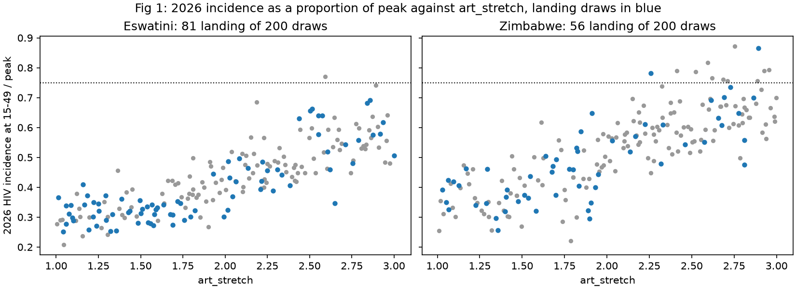
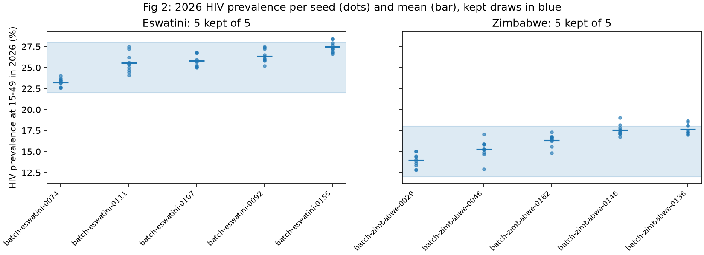
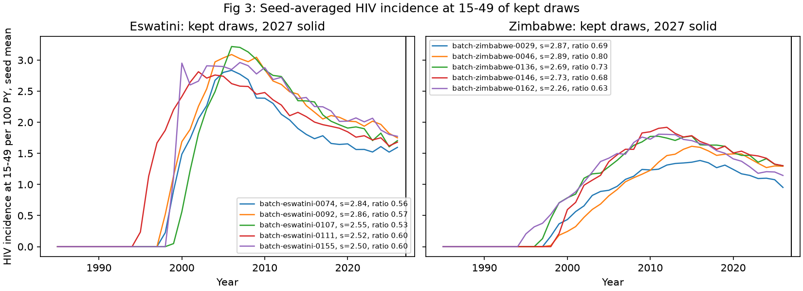

# Exp 40.2: Ensembles for the expanding settings, with a slower ART ramp-up and the intervention in 2027

**Date:** 2026-11-18.

**Question.** Which simulations make up the two expanding settings when ART scales up more
slowly than in the country tables, so that the intervention can stay in 2027? The
[README](README.md) follows [40.1](../40.1_peak_year_ensembles/SUMMARY.md), whose kept
draws have 2026 incidence at 15-49 at 0.27-0.35 of its peak in Eswatini and 0.38-0.48 in
Zimbabwe. Each country's ART table was stretched from 2004 by a drawn `art_stretch`
(`s`) of 1-3, each table year moving to `2004 + s × (year − 2004)`, in a 200-draw batch
per country over 40.1's ranges. The 5 landing draws per country with the highest 2026
incidence as a proportion of peak were replicated over 10 seeds. Both stages ran on
zebra.

**Result.** A slower ART ramp-up raises 2026 incidence relative to the peak, but not far
enough to give expanding epidemics in 2027, and the success criterion of 3 kept draws per
country at 0.75 or above is not met. All 10 replicated draws stay in their prevalence
cells. Their seed-averaged 2026 incidence is 0.53-0.60 of its peak in Eswatini (none at
0.75) and 0.63-0.80 in Zimbabwe (one at 0.75 or above, `batch-zimbabwe-0046`). The
seed-averaged peaks fall in 2002-2007 in Eswatini and 2011-2016 in Zimbabwe, so no draw
peaks near 2027.

## Observations

1. All 500 simulations finished. Mean run time at 10,000 agents, 1985 to the end of 2026,
   with 80 workers on zebra was 209 s in the batch (194-218 s) and 197 s in the replicate
   stage (160-210 s).
2. In the batch, 81 of 200 Eswatini draws land at 22-28% HIV prevalence at 15-49 in 2026
   and 56 of 200 Zimbabwe draws at 12-18%. Among landing draws, 2026 incidence as
   a proportion of peak rises with `s` (Spearman rank correlation 0.74 in both countries),
   from a median of 0.32 at `s` 1-1.5 to 0.58 at 2.5-3 in Eswatini and from 0.36 to 0.65
   in Zimbabwe (Fig 1). Across all draws, single-seed values reach 0.77 in Eswatini and
   0.87 in Zimbabwe. Among landing draws the maximum is 0.69 in Eswatini, and 2 Zimbabwe
   draws are at 0.75 or above.
3. A slower ramp-up raises 2026 prevalence, so the draws that slow the epidemic most land
   less often. Median 2026 prevalence goes from 24.4% at `s` 1-1.5 to 30.0% at 2.5-3 in
   Eswatini and from 16.1% to 20.2% in Zimbabwe, and the landing count falls from 27 of 49
   to 17 of 48 (Eswatini) and from 16 of 46 to 11 of 54 (Zimbabwe).
4. Per replicated draw, mean 2026 prevalence over 10 seeds (seed range), the peak year and
   the 2026-to-peak proportion of the seed-averaged incidence, and ART coverage of women
   aged 25-34 with HIV in 2026 from the stretched table:

   | Draw | `s` | HIV `beta_m2f` | 2026 prevalence, mean (range) | Peak year | 2026 / peak | 2026 ART |
   |---|---|---|---|---|---|---|
   | Eswatini `batch-eswatini-0074` | 2.84 | 0.0128 | 23.2% (22.6-24.0) | 2006 | 0.56 | 0.39 |
   | Eswatini `batch-eswatini-0092` | 2.86 | 0.0115 | 26.4% (25.2-27.5) | 2006 | 0.57 | 0.39 |
   | Eswatini `batch-eswatini-0107` | 2.55 | 0.0120 | 25.8% (25.0-26.8) | 2006 | 0.53 | 0.48 |
   | Eswatini `batch-eswatini-0111` | 2.52 | 0.0113 | 25.6% (24.1-27.5) | 2002 | 0.60 | 0.49 |
   | Eswatini `batch-eswatini-0155` | 2.50 | 0.0179 | 27.5% (26.6-28.4) | 2007 | 0.60 | 0.49 |
   | Zimbabwe `batch-zimbabwe-0029` | 2.87 | 0.0039 | 13.9% (12.8-15.0) | 2016 | 0.69 | 0.37 |
   | Zimbabwe `batch-zimbabwe-0046` | 2.89 | 0.0049 | 15.3% (12.9-17.0) | 2015 | 0.80 | 0.37 |
   | Zimbabwe `batch-zimbabwe-0136` | 2.69 | 0.0063 | 17.7% (17.0-18.7) | 2015 | 0.73 | 0.40 |
   | Zimbabwe `batch-zimbabwe-0146` | 2.73 | 0.0061 | 17.6% (16.7-19.0) | 2012 | 0.68 | 0.40 |
   | Zimbabwe `batch-zimbabwe-0162` | 2.26 | 0.0056 | 16.4% (14.8-17.3) | 2011 | 0.63 | 0.49 |

   The seed-to-seed standard deviation of 2026 prevalence is 0.50-1.13 percentage points.
   8 of the 100 seeds fall outside their cell, all above it: 2 of `batch-eswatini-0155`
   (28.4%), 4 of `batch-zimbabwe-0136` (up to 18.7%) and 2 of `batch-zimbabwe-0146` (up to
   19.0%).
5. Picking the highest single-seed ratios overstates them. The 5 Eswatini candidates had
   single-seed 2026-to-peak proportions of 0.64-0.69 in the batch against 0.53-0.60 in the
   seed average, and the Zimbabwe candidates 0.70-0.87 against 0.63-0.80.
   `batch-zimbabwe-0046` peaked in 2021 in its batch run and in 2015 in the seed average.
   Single-seed peaks span 2000-2011 across the Eswatini draws and 2008-2022 across the
   Zimbabwe draws.
6. The replicated draws pair a slow ramp-up (`s` 2.26-2.89) with low HIV `beta_m2f` for
   their country. Zimbabwe's are at 0.0039-0.0063, against 0.0069-0.0113 for 40.1's kept
   draws, and four of the five Eswatini draws are at 0.0113-0.0128, against 0.0125-0.0199.
   Their epidemics are flatter. Seed-averaged peak incidence at 15-49 is 2.81-3.22 per 100
   person-years in Eswatini and 1.39-1.92 in Zimbabwe, against 3.77-4.45 and 1.76-2.23 in
   40.1, and 2026 incidence is 1.60-1.77 and 0.95-1.30, against 1.17-1.40 and 0.85-0.96
   (Fig 3).
7. Eswatini's epidemics still peak before most ART. The stretched tables are 0 in 2004 and
   reach the 2011 row (0.32 of women aged 25-34 with HIV) in 2021-2024 at `s` 2.50-2.86,
   while seed-averaged incidence peaks in 2002-2007. The stretch slows the decline after
   the peak and leaves its timing to the network and HIV transmission.

## Next

ART timing alone does not give expanding epidemics in 2027. With `s` up to 3, which holds
2026 ART coverage of women aged 25-34 with HIV at 0.37-0.49, seed-averaged incidence
peaks at least 11 years before 2027 in both countries. The expanding cells stay on 40.1's
interim arrangement, intervened at each draw's peak year from
[40.1's ensembles.json](../40.1_peak_year_ensembles/ensembles.json), and issue 40 stays
open.

Issue 42 asks what slows the epidemic enough to peak near 2027. Its starting levers were
the ART delay and lower HIV `beta_m2f` with a later seed. This result settles the ART
lever: it raises 2026 incidence relative to the peak and leaves Eswatini's peak in
2002-2007. Lower HIV `beta_m2f` gave the flattest epidemics here (observation 6). The
next experiment on issue 42 explores how the epidemic's growth is set (HIV `beta_m2f`,
the seed year and the network's high-risk proportions) for a peak after 2020 with 2026
prevalence in each cell. It selects on a seed-averaged incidence curve, since single
seeds overstate the 2026-to-peak proportion (observation 5).
