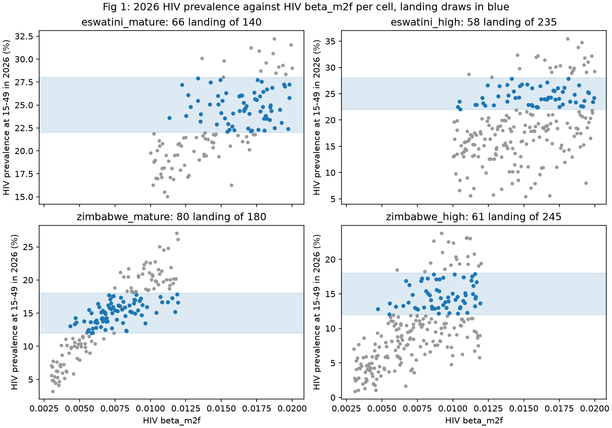
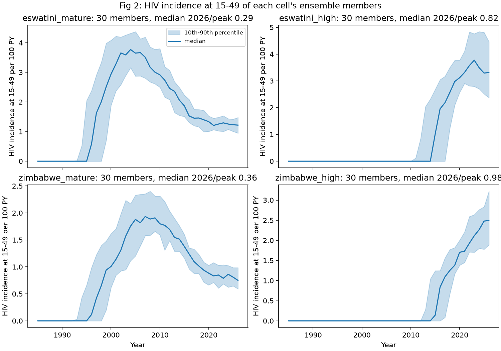

# Exp 43: 30-draw ensembles for the four settings, with the high-incidence cells delayed

**Date:** 2026-11-18.

**Question.** Which 30 simulations make up each of the four settings, when every cell is
intervened in 2027 and the high-incidence cells come from an HIV epidemic started later?
The [README](README.md) follows [40.1](../40.1_peak_year_ensembles/SUMMARY.md), which
intervened the expanding cells at each draw's 2003-2010 incidence peak, and
[40.2](../40.2_slower_art_ramp/SUMMARY.md), whose slower ART ramp-up left the peaks in
2002-2016. Each high-incidence draw here moves its HIV seed, ART and viral suppression
tables, VMMC table and HIV testing ramps later by a drawn `hiv_delay` of 17-23 years. One
800-draw batch ran on zebra, one seed per draw, over 40.1's ranges.

**Result.** All four cells have 30-member ensembles, written to
[ensembles.json](ensembles.json) with `intv_year` 2027, and the delayed cells are
expanding epidemics in 2026. Their members' incidence at 15-49 peaks in 2017-2026 (median
2022) in Eswatini and 2019-2026 (median 2025) in Zimbabwe, and their 2026 incidence is a
median 0.82 of its peak in Eswatini and 0.98 in Zimbabwe, against 0.29 and 0.36 in the
mature cells. HIV prevalence at 15-49 rises from 2020 to 2026 in all 60 delayed members
and falls in all 60 mature ones.

## Observations

1. All 800 simulations finished. Mean run time at 10,000 agents, 1985 to the end of 2026,
   with 80 workers on zebra was 211 s (198-222 s). One draw, in the Zimbabwe
   high-incidence cell, had 2026 HIV prevalence under 1%.
2. Landing draws (2026 HIV prevalence at 15-49 within 3 points of 25% Eswatini, 15%
   Zimbabwe) per cell, against the README's expected fraction: Eswatini mature 66 of 140
   (0.47, expected 0.46), Zimbabwe mature 80 of 180 (0.44, expected 0.35), Eswatini
   high-incidence 58 of 235 (0.25, expected 0.27), Zimbabwe high-incidence 61 of 245
   (0.25, expected 0.26). Reading the earlier batches at 2026 − `hiv_delay` predicted the
   delayed cells' landing fractions to within 0.02, so the inputs left on calendar years
   (demography, STI programmes) changed little.
3. In the delayed cells, landing falls with a longer delay. Landing draws by
   `hiv_delay` of 17-19, 19-21 and 21-23 years: 24 of 79, 18 of 76 and 16 of 80 in
   Eswatini, and 27 of 81, 21 of 86 and 13 of 78 in Zimbabwe. Among landing draws, a
   longer delay gives a later peak (Spearman rank correlation 0.40 in both countries).
4. Per cell, over its 30 members, median [range]:

   | Cell | 2026 prevalence | Peak year | 2026 / peak incidence | 2026 incidence per 100 PY | 2026 prevalence / incidence (years) |
   |---|---|---|---|---|---|
   | Eswatini, mature | 24.2% [22.1-27.7] | 2003 [1997-2007] | 0.29 [0.22-0.41] | 1.22 [0.90-1.83] | 19.7 [15.1-26.1] |
   | Eswatini, high-incidence | 23.7% [22.4-27.2] | 2022 [2017-2026] | 0.82 [0.60-1.00] | 3.31 [2.00-6.13] | 7.3 [4.2-11.4] |
   | Zimbabwe, mature | 14.1% [12.0-17.7] | 2008 [2002-2011] | 0.36 [0.27-0.55] | 0.75 [0.54-1.25] | 18.2 [13.4-25.5] |
   | Zimbabwe, high-incidence | 14.7% [12.2-17.8] | 2025 [2019-2026] | 0.98 [0.79-1.00] | 2.49 [1.68-3.56] | 6.0 [4.0-9.0] |

   2026 incidence is at or above 0.75 of its peak in 21 of 30 Eswatini high-incidence
   members and all 30 Zimbabwe ones, against none in either mature cell. 12 Zimbabwe and
   1 Eswatini high-incidence member peak in 2026 itself, so their incidence is still
   rising. The [settings decision](../../../docs/pages/settings-prevalence-by-phase.md)
   quotes prevalence-to-incidence ratios of 4.6 years for Mwanza's expanding epidemic and
   10-15 years for the mature trial sites.
5. HIV prevalence at 15-49 changes from 2020 to 2026 by +13.6 percentage points [3.7-22.3]
   in the Eswatini high-incidence members and +9.0 [4.9-13.4] in the Zimbabwe ones,
   against −3.3 [−4.7 to −2.1] and −2.4 [−4.4 to −1.3] in the mature cells.
6. The delayed cells intervene early in ART scale-up. With the table moved by the member's
   `hiv_delay`, ART coverage of women aged 25-34 with HIV in 2026 is a median 0.12
   [0-0.23] in Eswatini and 0.11 [0-0.22] in Zimbabwe, 4 members per country at 0, against
   0.89 (Eswatini 2021 row) and 0.80 (Zimbabwe 2020 row) for the mature cells. A
   difference between a country's mature and high-incidence cells therefore carries ART
   coverage as well as phase, as in 40.1, at the same position relative to the epidemic.
7. The delayed Zimbabwe members need higher HIV `beta_m2f` to land: median 0.0090
   [0.0072-0.0117] against 0.0067 [0.0044-0.0112] for the mature Zimbabwe members, since
   a shorter epidemic has to reach 12-18% by 2026. Eswatini's are similar, 0.0159
   [0.0104-0.0195] against 0.0166 [0.0113-0.0198].
8. Median 2026 STI prevalence at 15-49 across members, in the order gonorrhoea, chlamydia,
   trichomoniasis, any-stage syphilis, RPR-positive syphilis: Eswatini mature 5.2%, 11.0%,
   14.1%, 23.6%, 20.1%; Eswatini high-incidence 4.5%, 14.4%, 16.9%, 26.2%, 21.8%; Zimbabwe
   mature 6.1%, 10.4%, 9.1%, 22.8%, 19.6%; Zimbabwe high-incidence 3.5%, 10.3%, 15.8%,
   23.4%, 20.4%. RPR-positive syphilis sits above the STIPS band of 0.8-11.5% in every
   cell, as in [38.3](../38.3_seed_year_lower_sti_beta/SUMMARY.md).
9. Each member ran on one seed. In 40.2, single-seed 2026-to-peak proportions overstated
   the seed average by up to 0.15, and in 40.1 a member's 10-seed mean 2026 prevalence sat
   up to 1.2 points from its single-seed value. Members within about 1 point of a cell
   edge may leave the cell when rerun on other seeds.

## Next

The four ensembles in [ensembles.json](ensembles.json) replace 40.1's interim
arrangement. The decomposition track runs its arms on them with
`setting_pars(draw, country, sim=dict(stop=2040), intv_year=2027)`, each member's `draw`
carrying its `hiv_delay`. Issue 42 is answered: delaying the HIV seed and its programmes
by 17-23 years gives epidemics that peak near 2027 at each cell's 2026 prevalence.

The [settings decision](../../../docs/pages/settings-prevalence-by-phase.md) describes
phase as judged from the incidence curve and shares HIV biology across settings. It
needs revising to record that phase is set by `hiv_delay`, HIV `beta_m2f` differs by
country, and the high-incidence cells intervene at ART coverage of 0-0.23. If behavioral
PrEP becomes a baseline from 2017 (issue 29), its start moves by `hiv_delay` too.
